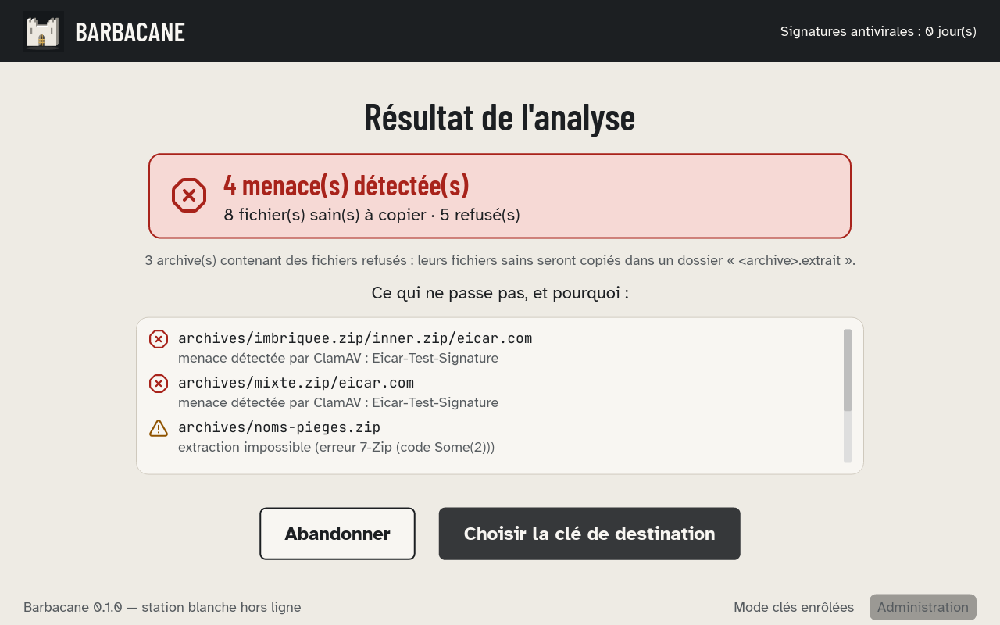
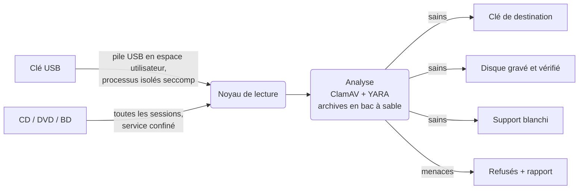

<div align="center">
  
  <h1>BARBACANE</h1>
  <p><strong>Borne de décontamination hors ligne pour clés USB et disques optiques.</strong><br>
  <em>Contrôlez. Filtrez. Sécurisez.</em></p>
  <p>
    <a href="https://github.com/Titouanlvt/Barbacane/actions/workflows/ci.yml"></a>
    <a href="https://github.com/Titouanlvt/Barbacane/actions/workflows/iso.yml"></a>
    <a href="LICENSE"></a>
    
    
  </p>
  <p>
    <a href="docs/guide-installation-poste.md"><strong>Installer une borne</strong></a> ·
    <a href="docs/Barbacane-installation.pdf">Guide du technicien (PDF)</a> ·
    <a href="docs/preuves/README.md">Preuves</a> ·
    <a href="docs/conception.md">Conception</a>
  </p>
</div>

<br>

> Une **barbacane** est l'ouvrage avancé qui protège l'entrée d'un château.
> La borne Barbacane est l'endroit où un support inconnu s'arrête avant d'atteindre votre réseau.

<p align="center">
  
  
</p>

## Ce que fait la borne

Un poste dédié sous Debian 13, **jamais connecté au réseau**, piloté à l'écran tactile ou à la
souris. On y insère une clé USB ou un disque d'origine inconnue : la borne le lit **sans le
monter**, analyse **chaque fichier**, archives comprises, puis au choix :

| | |
|---|---|
| **Copier** | les seuls fichiers sains vers une clé de destination effacée (ou limitée aux clés enrôlées) |
| **Graver** | les fichiers sains sur un disque réinscriptible (CD-RW, DVD±RW, BD-RE), relus et vérifiés |
| **Blanchir** | le support lui-même : effacement **complet**, puis réécriture des seuls fichiers sains |

Chaque passage laisse un rapport lisible (`.txt` et `.html`) : ce qui est passé, ce qui a été
refusé, et pourquoi.

## Comment ça marche



- **Rien n'est exécuté ni monté par le système.** Les clés sont lues par une pile USB en espace
  utilisateur, découpée en processus isolés (seccomp, Landlock), héritée
  d'[usbsas](docs/noyau/usbsas.md) (CEA). Les disques optiques sont lus par un service séparé,
  sans réseau, limité au seul lecteur.
- **Analyse en profondeur.** ClamAV et YARA ; archives (zip, 7z, rar, iso…) extraites
  récursivement dans `bubblewrap`, avec limites contre les bombes de décompression ; mot de passe
  demandé à l'écran pour les archives chiffrées. Sur un disque, **toutes les sessions** sont
  lues : rien ne se cache dans une session masquée.
- **Hors ligne de bout en bout.** Installation par ISO sans réseau ; signatures antivirales et
  logiciel mis à jour par clé USB **signée** (minisign), versions anciennes refusées.
- **Administration à l'écran.** PIN (Argon2id, verrouillage après 5 essais), clés de sortie
  enrôlées, limites d'analyse, export des journaux. GRUB verrouillé, clavier sans effet.

## Installer une borne

```shell
# Sur un poste administrateur Debian 13 connecté à Internet, en root
apt-get install -y git minisign
git clone https://github.com/Titouanlvt/Barbacane.git barbacane && cd barbacane
borne/update/barbacane-update-keygen ~/cles-barbacane          # clé de signature des mises à jour
cp ~/cles-barbacane/barbacane-maj.pub systeme/iso/maj.pub
systeme/iso/build-iso.sh --sortie barbacane.iso                # ≈ 10 à 40 min
```

Copiez l'ISO sur une clé (`dd`, Rufus en mode image DD ou balenaEtcher), démarrez le poste
dessus : l'installation est **automatique** et efface le disque interne. Au premier démarrage,
**Administration** → choisissez le PIN.

Pas à pas complet : [guide d'installation](docs/guide-installation-poste.md) ·
[guide du technicien en PDF](docs/Barbacane-installation.pdf).

## Éprouvé sur du vrai matériel

Toutes les fonctions sont prouvées sur une borne installée **depuis une vraie clé USB**, pilotée
uniquement par l'écran, avec de vraies clés et un vrai graveur : captures, empreintes SHA-256 et
journaux dans [`docs/preuves/`](docs/preuves/README.md).

| Campagne | Résultat |
|---|---|
| Clés USB : PIN, enrôlement, transfert, archives chiffrées, blanchiment, mises à jour, clés hostiles | **53 OK, 0 échec** |
| Disques optiques : lecture multisession, gravure vérifiée, blanchiment d'un CD-RW | **27 OK, 0 échec** |
| Guide suivi depuis zéro sur une Debian vierge | ISO construite et installée sans intervention |

Ce qui n'a pas pu être testé (DVD, Blu-ray, poste physique…) est listé avec la raison dans
[le bilan des preuves](docs/preuves/README.md).

## Documentation

| | |
|---|---|
| [Utilisation](docs/exploitation.md) | copier, graver, blanchir, messages à l'écran |
| [Administration](docs/administration.md) | PIN, mises à jour signées, clés enrôlées, limites |
| [Installation](docs/installation.md) · [guide poste](docs/guide-installation-poste.md) · [PDF](docs/Barbacane-installation.pdf) | matériel, ISO, premier démarrage |
| [Conception](docs/conception.md) · [disques optiques](docs/conception-optique.md) | architecture, modèle de menace, choix techniques |
| [Revue de sécurité](docs/revue-securite.md) · [incident Proxmox](docs/incident-proxmox.md) | constats, corrections, garde-fous |
| [Tests](docs/tests.md) · [**Preuves**](docs/preuves/README.md) | tests automatiques, campagnes sur vrai matériel |
| [Noyau](docs/noyau/architecture.md) · [écarts avec usbsas](docs/noyau/ecarts.md) | pile de lecture USB issue d'usbsas |
| [Charte graphique](docs/charte/README.md) | couleurs, typographie, logo, composants |

## Organisation du dépôt

| Dossier | Contenu |
|---|---|
| `noyau/` | pile de lecture/écriture USB isolée, issue d'usbsas (CEA) |
| `borne/` | `client` (interface), `analyzer` (ClamAV, YARA, archives), `optique` (lecteur de disques), `admind`, `parcours`, `update` |
| `systeme/` | ISO hors ligne, paquets Debian, unités systemd, durcissement |
| `tests/` | mock et EICAR, interface sous Xvfb, mises à jour, ISO sous QEMU, campagnes Proxmox |
| `docs/` | documentation, guide PDF, charte, preuves |

## Développement

```shell
tests/phase1-mock.sh                                   # noyau en mode mock + EICAR
cargo test                                             # noyau, analyseur, optique, parcours de bout en bout
cargo build -p barbacane-admind && tests/maj/maj.sh    # mises à jour signées
docs/pdf/generer.sh                                    # guide PDF (pandoc + weasyprint)
```

Dépendances (Debian 13) : `pkgconf clang cmake libssl-dev libkrb5-dev libseccomp-dev libudev-dev
libusb-1.0-0-dev protobuf-compiler libdbus-1-dev libwayland-dev libxkbcommon-dev libfuse3-dev
clamav-daemon 7zip bubblewrap minisign xorriso dosfstools mtools exfatprogs ntfs-3g`.

> **Jamais sur un hyperviseur.** Les scripts et paquets refusent de s'installer sur un hôte
> Proxmox (`/etc/pve`) : une borne s'installe sur un poste dédié ou dans une VM.

## Licence

GPLv3. Le noyau de lecture USB provient d'[usbsas](https://github.com/cea-sec/usbsas)
(CEA, GPLv3) ; Barbacane l'intègre et le maintient de façon autonome.
