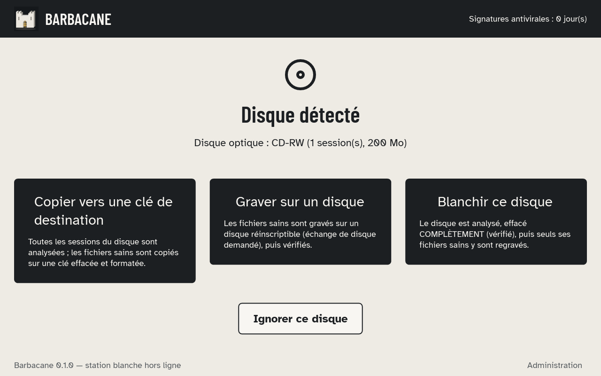
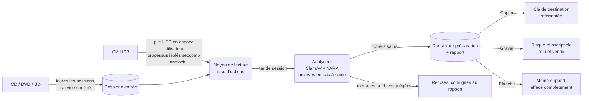

<div align="center">
  
  <h1>BARBACANE</h1>
  <p><strong>Borne de décontamination hors ligne pour clés USB et disques optiques.</strong><br>
  <em>Contrôlez. Filtrez. Sécurisez.</em></p>
  <p>
    <a href="https://github.com/Titouanlvt/Barbacane/actions/workflows/ci.yml"></a>
    <a href="https://github.com/Titouanlvt/Barbacane/actions/workflows/iso.yml"></a>
    <a href="LICENSE"></a>
    
    
  </p>
  <p>
    <a href="docs/guide-installation-poste.md"><strong>Installer une borne</strong></a> ·
    <a href="docs/Barbacane-installation.pdf">Guide du technicien (PDF)</a> ·
    <a href="docs/preuves/README.md">Preuves</a> ·
    <a href="docs/conception.md">Conception</a>
  </p>
</div>

<br>

> Une **barbacane** est l'ouvrage avancé qui protège l'entrée d'un château.
> La borne Barbacane est l'endroit où un support inconnu s'arrête avant d'atteindre votre réseau.

<p align="center">
  
  
</p>

## Ce que fait la borne

Un poste dédié sous Debian 13, **jamais connecté au réseau**, piloté à l'écran tactile ou à la
souris. On y insère une clé USB ou un disque d'origine inconnue : la borne le lit **sans le
monter**, analyse **chaque fichier**, archives comprises, puis au choix :

| | |
|---|---|
| **Copier** | les seuls fichiers sains vers une clé de destination effacée (ou limitée aux clés enrôlées) |
| **Graver** | les fichiers sains sur un disque réinscriptible (CD-RW, DVD±RW, BD-RE), relus et vérifiés |
| **Blanchir** | le support lui-même : effacement **complet**, puis réécriture des seuls fichiers sains |

Chaque passage laisse un rapport lisible (`.txt` et `.html`) : ce qui est passé, ce qui a été
refusé, et pourquoi.

## Comment ça marche

### Vue d'ensemble



Chaque passage se fait en **deux transferts séparés** :

1. **Analyse** : le support inconnu est lu et tous ses fichiers partent à l'analyseur. Rien n'est
   encore écrit nulle part ; le support d'origine n'est pas modifié.
2. **Écriture** : seuls les fichiers déclarés sains, et ceux extraits sains des archives, sont
   déposés dans un **dossier de préparation**. C'est ce dossier, jamais le support d'origine, qui
   est écrit sur la clé, gravé ou réécrit.

Ce découpage garantit qu'un fichier non analysé ne peut pas atteindre la sortie : il n'est
tout simplement pas dans le dossier de préparation.

### 1. Lecture d'une clé USB, sans la confier au système

Le système de la borne **ne monte jamais** une clé : les pilotes noyau `usb_storage` et `uas`,
ainsi que les systèmes de fichiers rares (`hfs`, `udf`, `squashfs`, `cramfs`…), sont désactivés.
La clé est pilotée par une pile USB en **espace utilisateur**, héritée
d'[usbsas](docs/noyau/usbsas.md) (CEA) et découpée en petits processus qui ne se font pas
confiance :

| Processus | Rôle |
|---|---|
| `usbdev` | surveille les branchements, filtre par port et par numéro de série |
| `dev2scsi` / `scsi2files` | parle SCSI à la clé, lit FAT, exFAT, NTFS, ext4, ISO 9660 |
| `files2tar` | copie les fichiers choisis dans un tar de session |
| `analyzer` | envoie le tar à l'analyseur local (un seul port autorisé) |
| `files2fs` / `fs2dev` | construit le système de fichiers de sortie hors périphérique, puis l'écrit |

Chaque processus est enfermé par **seccomp**, qui ne lui laisse que les appels système dont il a
besoin, sur des descripteurs ouverts d'avance. **Landlock** restreint en plus les accès réseau
et les dossiers locaux. Un lecteur de système de fichiers piégé ne peut donc ni ouvrir de fichier, ni joindre le
réseau, ni toucher à la clé de sortie. Ces processus sont relancés entre deux opérations.

### 2. Analyse de chaque fichier

L'analyseur (`barbacane-analyzer`, service local sans accès réseau) traite chaque fichier du tar :

- **empreinte SHA-256** et **type réel** (signature magique, pas l'extension : un `.jpg` qui
  contient un exécutable est vu comme tel) ;
- **ClamAV** (base mise à jour par clé signée) et **règles YARA** ;
- **archives** (zip, 7z, rar, tar, iso, msi…) : extraites avec `7zz` dans **bubblewrap**
  (aucun réseau, système de fichiers temporaire, mémoire et durée bornées), puis analysées
  récursivement ;
- **limites contre les bombes de décompression** : profondeur 5, 10 000 fichiers, 4 Go
  décompressés, taux de compression 100:1 au plus, 5 min par archive. Au-delà, l'archive est
  refusée ;
- **noms piégés** (`../`, chemins absolus, liens, caractères de contrôle, noms trop longs) :
  jamais écrits ;
- **archive chiffrée** : la borne demande le mot de passe au clavier virtuel (3 essais, 5 min).
  Il n'est jamais journalisé et il est effacé de la mémoire après usage. Sans mot de passe,
  l'archive est refusée.

Une archive n'est déclarée saine que si **tout** son contenu l'est. Sinon, elle est refusée et
seuls ses fichiers sains sont extraits vers la sortie (dossier `archive.zip.extrait/`). Si
l'analyseur ou ClamAV est indisponible, **tout est refusé** : la borne échoue en position fermée.

### 3. Écriture de la sortie

- **Copier** : la clé de destination est **reformatée** (exFAT). Le système de fichiers est
  construit à part, puis écrit sur la clé : aucun ancien fichier n'y survit. En mode « clés
  enrôlées », seules les clés dont le numéro de série est inscrit sont acceptées ; une autre clé
  est refusée sans qu'un seul octet n'y soit écrit.
- **Blanchir** : après confirmation, la clé d'origine est **remplie de zéros** sur toute sa
  surface, puis les fichiers sains y sont réécrits. Si l'écriture échoue, le dossier de
  préparation est conservé pour réessayer sans refaire l'analyse.
- **Rapport** : `rapport-barbacane-<date>.txt` et `.html` sont joints à la sortie. Ils listent
  chaque fichier `[COPIÉ]` ou `[REFUSÉ]` avec sa raison (signature ClamAV, règle YARA, archive
  chiffrée, nom dangereux…).

### 4. Disques optiques

Le lecteur est confié à un service séparé, `barbacane-optique`, qui tourne sous un compte dédié.
Il n'a aucun accès réseau et ne voit que le lecteur. Chaque opération passe par `xorriso`, lancé
dans bubblewrap.

- **Lecture** : le disque est identifié (CD-RW, DVD+RW, BD-RE…), puis **chaque session de
  données** est extraite dans `session-1/`, `session-2/`… Un fichier masqué par une session plus
  récente est donc analysé lui aussi. Les CD audio et les disques illisibles sont refusés. Le
  dossier extrait suit ensuite exactement le chemin d'une clé : même analyseur, même rapport.
- **Gravure** : uniquement sur un disque **réinscriptible** (CD-RW, DVD±RW, BD-RE, DVD-RAM).
  Le disque est d'abord **entièrement effacé**, jamais par l'effacement rapide qui laisse les
  données lisibles, et l'effacement est vérifié par relecture. Les fichiers sont ensuite gravés à
  la **vitesse la plus basse** acceptée, puis **relus** et comparés fichier par fichier (SHA-256).
- **Fin** : le disque est éjecté. Durées et vitesses sont consignées au journal.

### 5. Une borne fermée

| Couche | Mesure |
|---|---|
| Réseau | aucune carte utilisée, pare-feu nftables qui refuse tout en entrée, en sortie et en transit |
| Démarrage | GRUB protégé par mot de passe (Échap n'ouvre pas le menu), BIOS verrouillé et démarrage sur le disque interne (guide) |
| Interface | kiosque plein écran (`cage`), le clavier physique n'a aucun effet |
| Administration | PIN haché en Argon2id, verrouillage après 5 erreurs, fin de session après 15 min d'inactivité |
| Services | unités systemd durcies : comptes dédiés, système en lecture seule, appels système et périphériques filtrés |
| Mises à jour | paquet signé (minisign) par la clé du parc, version plus ancienne refusée, appliqué depuis une clé USB |


## Installer une borne

```shell
# Sur un poste administrateur Debian 13 connecté à Internet, en root
apt-get install -y git minisign
git clone https://github.com/Titouanlvt/Barbacane.git barbacane && cd barbacane
borne/update/barbacane-update-keygen ~/cles-barbacane          # clé de signature des mises à jour
cp ~/cles-barbacane/barbacane-maj.pub systeme/iso/maj.pub
systeme/iso/build-iso.sh --sortie barbacane.iso                # ≈ 10 à 40 min
```

Copiez l'ISO sur une clé (`dd`, Rufus en mode image DD ou balenaEtcher), démarrez le poste
dessus : l'installation est **automatique** et efface le disque interne. Au premier démarrage,
**Administration** → choisissez le PIN.

Pas à pas complet : [guide d'installation](docs/guide-installation-poste.md) ·
[guide du technicien en PDF](docs/Barbacane-installation.pdf).

## Éprouvé sur du vrai matériel

Toutes les fonctions sont prouvées sur une borne installée **depuis une vraie clé USB**, pilotée
uniquement par l'écran, avec de vraies clés et un vrai graveur : captures, empreintes SHA-256 et
journaux dans [`docs/preuves/`](docs/preuves/README.md).

| Campagne | Résultat |
|---|---|
| Clés USB : PIN, enrôlement, transfert, archives chiffrées, blanchiment, mises à jour, clés hostiles | **53 OK, 0 échec** |
| Disques optiques : lecture multisession, gravure vérifiée, blanchiment d'un CD-RW | **27 OK, 0 échec** |
| Guide suivi depuis zéro sur une Debian vierge | ISO construite et installée sans intervention |

Ce qui n'a pas pu être testé (DVD, Blu-ray, poste physique…) est listé avec la raison dans
[le bilan des preuves](docs/preuves/README.md).

## Documentation

| | |
|---|---|
| [Utilisation](docs/exploitation.md) | copier, graver, blanchir, messages à l'écran |
| [Administration](docs/administration.md) | PIN, mises à jour signées, clés enrôlées, limites |
| [Installation](docs/installation.md) · [guide poste](docs/guide-installation-poste.md) · [PDF](docs/Barbacane-installation.pdf) | matériel, ISO, premier démarrage |
| [Conception](docs/conception.md) · [disques optiques](docs/conception-optique.md) | architecture, modèle de menace, choix techniques |
| [Revue de sécurité](docs/revue-securite.md) · [incident Proxmox](docs/incident-proxmox.md) | constats, corrections, garde-fous |
| [Tests](docs/tests.md) · [**Preuves**](docs/preuves/README.md) | tests automatiques, campagnes sur vrai matériel |
| [Noyau](docs/noyau/architecture.md) · [écarts avec usbsas](docs/noyau/ecarts.md) | pile de lecture USB issue d'usbsas |
| [Charte graphique](docs/charte/README.md) | couleurs, typographie, logo, composants |

## Organisation du dépôt

| Dossier | Contenu |
|---|---|
| `noyau/` | pile de lecture/écriture USB isolée, issue d'usbsas (CEA) |
| `borne/` | `client` (interface), `analyzer` (ClamAV, YARA, archives), `optique` (lecteur de disques), `admind`, `parcours`, `update` |
| `systeme/` | ISO hors ligne, paquets Debian, unités systemd, durcissement |
| `tests/` | mock et EICAR, interface sous Xvfb, mises à jour, ISO sous QEMU, campagnes Proxmox |
| `docs/` | documentation, guide PDF, charte, preuves |

## Développement

```shell
tests/phase1-mock.sh                                   # noyau en mode mock + EICAR
cargo test                                             # noyau, analyseur, optique, parcours de bout en bout
cargo build -p barbacane-admind && tests/maj/maj.sh    # mises à jour signées
docs/pdf/generer.sh                                    # guide PDF (pandoc + weasyprint)
```

Dépendances (Debian 13) : `pkgconf clang cmake libssl-dev libkrb5-dev libseccomp-dev libudev-dev
libusb-1.0-0-dev protobuf-compiler libdbus-1-dev libwayland-dev libxkbcommon-dev libfuse3-dev
clamav-daemon 7zip bubblewrap minisign xorriso dosfstools mtools exfatprogs ntfs-3g`.

> **Jamais sur un hyperviseur.** Les scripts et paquets refusent de s'installer sur un hôte
> Proxmox (`/etc/pve`) : une borne s'installe sur un poste dédié ou dans une VM.

## Licence

GPLv3. Le noyau de lecture USB provient d'[usbsas](https://github.com/cea-sec/usbsas)
(CEA, GPLv3) ; Barbacane l'intègre et le maintient de façon autonome.
