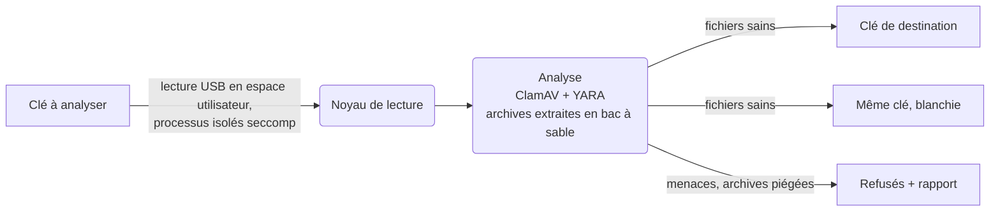

<div align="center">
  
  <h1>BARBACANE</h1>
  <p><strong>Borne de décontamination de clés USB, hors ligne.</strong><br>
  Contrôlez. Filtrez. Sécurisez.</p>
  <p>
    <a href="https://github.com/Titouanlvt/Barbacane/actions/workflows/ci.yml"></a>
    <a href="https://github.com/Titouanlvt/Barbacane/actions/workflows/iso.yml"></a>
    <a href="LICENSE"></a>
  </p>
</div>

> Une **barbacane** est l'ouvrage avancé qui contrôle l'entrée d'un château. La borne
> Barbacane est l'endroit où une clé inconnue s'arrête avant d'atteindre votre réseau.

Barbacane est un poste dédié (Debian 13, **jamais connecté au réseau**) piloté à la
souris. On y branche une clé d'origine inconnue ; la borne la lit sans la monter,
analyse **chaque fichier**, y compris le contenu des archives, puis :

- **copie** les seuls fichiers sains vers une clé de destination (éventuellement limitée
  aux clés enrôlées) ;
- ou **blanchit** la clé elle-même : effacement complet, puis réécriture des fichiers sains.

Chaque passage produit un rapport lisible : ce qui est passé, ce qui a été refusé et pourquoi.

## Comment ça marche



- **Aucun fichier n'est exécuté ni ouvert par le système** : la clé est lue par une pile
  USB en espace utilisateur, découpée en processus isolés (héritée d'[usbsas](docs/noyau/usbsas.md), CEA).
- **Analyse en profondeur** : ClamAV et YARA, extraction récursive des archives (zip, 7z,
  rar, iso…) dans `bubblewrap`, limites anti-bombe, archives chiffrées traitées avec mot de passe.
- **Hors ligne de bout en bout** : installation par ISO, mises à jour de signatures et de
  logiciel par clé administrateur **signée** (minisign).
- **Administration à l'écran** : PIN (Argon2id), clés de sortie enrôlées, limites, export des journaux.

## Démarrage rapide

```shell
# Construire l'ISO d'installation (Debian 13 ou conteneur debian:trixie --privileged)
sudo systeme/iso/build-iso.sh --sortie barbacane.iso
```

Gravez l'ISO sur une clé, démarrez le poste dessus : l'installation est **automatique**
et efface le disque interne. Au premier démarrage, **Administration** → choisissez le PIN.
Guide pas à pas : [installer un poste](docs/guide-installation-poste.md).

## Documentation

| | |
|---|---|
| [Utilisation](docs/exploitation.md) | copier, blanchir, messages à l'écran |
| [Administration](docs/administration.md) | PIN, mises à jour signées, clés enrôlées, limites |
| [Installation](docs/installation.md) · [Guide poste](docs/guide-installation-poste.md) | matériel (16 Go de RAM), ISO, premier démarrage |
| [Conception](docs/conception.md) | architecture, modèle de menace, choix techniques |
| [Tests](docs/tests.md) · [**Preuves**](docs/preuves/README.md) | tests automatiques, preuves sur vraies clés USB |
| [Charte graphique](docs/charte/README.md) | couleurs, typographie, logo, composants |
| [Noyau](docs/noyau/architecture.md) · [écarts](docs/noyau/ecarts.md) | pile de lecture USB issue d'usbsas |

## Organisation du dépôt

| Dossier | Contenu |
|---|---|
| `noyau/` | pile de lecture/écriture USB isolée, issue d'usbsas (CEA) ; écarts listés dans `docs/noyau/ecarts.md` |
| `borne/` | `client` (interface iced, paquet `barbacane`), `analyzer`, `admind`, `parcours`, `update` (outils du poste admin) |
| `systeme/` | ISO hors ligne, paquets Debian, systemd, durcissement (nftables, sysctl, modprobe) |
| `tests/` | mock et EICAR, interface sous Xvfb, mises à jour, ISO sous QEMU, preuve Proxmox sur vraies clés |
| `docs/` | documentation, charte graphique, preuves |

## Développement

```shell
tests/phase1-mock.sh                     # noyau en mode mock + test d'intégration EICAR
cargo test                               # noyau, analyseur, archives, admind, parcours de bout en bout
cargo build -p barbacane-admind && tests/maj/maj.sh   # mises à jour signées
```

Dépendances (Debian 13) : `pkgconf clang cmake libssl-dev libkrb5-dev libseccomp-dev libudev-dev
libusb-1.0-0-dev protobuf-compiler libdbus-1-dev libwayland-dev libxkbcommon-dev libfuse3-dev
clamav-daemon 7zip bubblewrap minisign dosfstools mtools exfatprogs ntfs-3g`.

## Licence

GPLv3. Le noyau de lecture USB provient d'[usbsas](https://github.com/cea-sec/usbsas)
(CEA, GPLv3) ; Barbacane l'intègre et le maintient de façon autonome.
