# À qui s'adresse ce guide

Vous devez installer et faire vivre une **borne Barbacane** : un poste dédié, jamais
connecté au réseau, qui vérifie les clés USB d'origine inconnue. Il analyse tous les fichiers
(antivirus ClamAV, règles YARA, contenu des archives) puis :

- **copie** les seuls fichiers sains vers une clé de destination ;
- ou **blanchit** la clé : effacement complet, puis réécriture des seuls fichiers sains.

Aucune connaissance du projet n'est nécessaire. Comptez une demi-journée pour la première
borne (dont 40 minutes de construction de l'ISO), 30 minutes pour les suivantes.

Les captures d'écran de ce guide proviennent d'une vraie borne, installée et testée avec
de vraies clés USB (dossier `docs/preuves` du dépôt).

# 1. Matériel nécessaire et réglages BIOS

## Matériel

| Élément | Exigence |
|---|---|
| Poste borne | PC x86_64 (HP ProDesk, Dell OptiPlex…), UEFI, 16 Go de RAM recommandés (8 Go testés), disque interne de 32 Go minimum. **Le disque sera entièrement effacé.** |
| Périphériques | écran + **souris USB**. Pas de clavier : la borne n'en gère aucun. |
| Ports USB | un port « ENTRÉE » (clé à analyser), un port « SORTIE » (clé de destination), un port souris. Préférer des ports USB 3 (bleus) : les clés y sont jusqu'à dix fois plus rapides. |
| Clé d'installation | clé USB de 2 Go minimum (son contenu sera effacé). |
| Poste administrateur | PC sous Debian 13 **connecté à Internet**, droits root, 20 Go libres. Il fabrique l'ISO et signe les mises à jour. Ce n'est jamais la borne. |
| Clés de destination | clés USB de bonne qualité, avec un numéro de série (nécessaire à l'enrôlement). |

## Réglages BIOS / UEFI de la borne

Entrer dans le BIOS (**F10** sur HP, **F2** sur Dell).

Avant l'installation :

1. Mode de démarrage **UEFI**.
2. Autoriser le démarrage sur USB (le temps de l'installation seulement).
3. Désactiver Secure Boot seulement si le poste refuse de démarrer sur la clé.

Après l'installation (§4) :

1. **Démarrage sur le disque interne uniquement** : désactiver USB, réseau (PXE), lecteur optique
   et le menu de démarrage F9/F12.
2. **Mot de passe administrateur BIOS**, conservé avec les secrets de l'administration.
3. Désactiver Wake-on-LAN, Intel AMT/vPro, Wi-Fi, Bluetooth et Thunderbolt si le BIOS le permet.
4. Activer VT-d / IOMMU (protection contre les attaques par accès mémoire direct).
5. **Ne jamais brancher de câble réseau.** Les mises à jour du BIOS se font par clé USB.

# 2. Préparation sur le poste administrateur

Toutes les commandes se tapent **en root** sur le poste administrateur connecté
(`su -` si `sudo` n'est pas installé).

## 2.1 Récupérer Barbacane

```sh
apt-get update && apt-get install -y git minisign
git clone https://github.com/Titouanlvt/Barbacane.git barbacane
cd barbacane
```

## 2.2 Créer la clé de signature des mises à jour

Une seule fois pour tout le parc. Choisissez une phrase de passe solide (demandée deux fois).

```sh
borne/update/barbacane-update-keygen ~/cles-barbacane
```

Deux fichiers sont créés :

- `barbacane-maj.key` : clé **secrète**. Quiconque la détient (avec la phrase de passe) peut
  faire installer n'importe quoi sur les bornes. Gardez-la sur ce poste ou sur une clé USB
  chiffrée rangée au coffre ; **jamais** sur une borne.
- `barbacane-maj.pub` : clé publique, intégrée à l'ISO.

## 2.3 Construire l'ISO

```sh
cp ~/cles-barbacane/barbacane-maj.pub systeme/iso/maj.pub
systeme/iso/build-iso.sh --sortie barbacane.iso      # 30 à 40 minutes
sha256sum barbacane.iso                               # à noter avec la date
```

L'ISO contient tout : Debian 13, Barbacane, la base antivirale du jour. **L'installation ne
demande aucun réseau.** Sans `maj.pub`, aucune mise à jour ne pourra jamais être appliquée.

## 2.4 Copier l'ISO sur une clé USB

Une erreur de cible efface un disque du poste : identifiez la clé **avant** de copier.

```sh
lsblk -d -o NAME,SIZE,TRAN,MODEL,SERIAL
```

La clé est la ligne dont `TRAN` vaut `usb`, avec la taille et le modèle attendus
(ici `/dev/sdX`). Puis :

```sh
dd if=barbacane.iso of=/dev/sdX bs=4M status=progress conv=fsync
cmp -n "$(stat -c %s barbacane.iso)" barbacane.iso /dev/sdX && echo "copie vérifiée"
```

Sous Windows : Rufus en mode **« image DD »**.

# 3. Installation de la borne

1. Brancher la clé d'installation, allumer, choisir la clé dans le menu de démarrage
   (**F9** HP, **F12** Dell).
2. L'installation démarre seule au bout de 10 secondes. **Ne rien toucher.**
   Le plus grand disque interne est effacé (jamais un disque USB).


3. Le poste redémarre tout seul (≈ 15 minutes). **Retirer la clé d'installation.**
4. L'écran d'accueil de Barbacane apparaît.

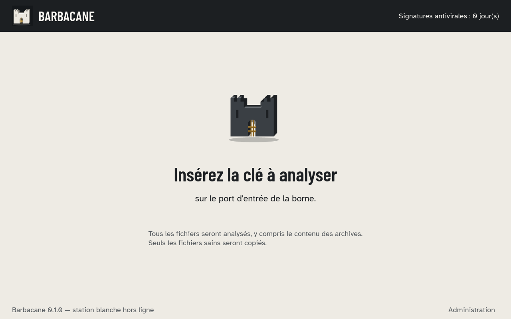

5. Appliquer les réglages BIOS « après l'installation » (§1).

# 4. Premier démarrage et PIN

**Choisissez le PIN immédiatement** : tant qu'aucun PIN n'existe, le premier venu peut le choisir.

1. Cliquer sur **Administration**, en bas à droite.
2. L'écran indique « Premier démarrage : choisissez le PIN administrateur ». Saisir au moins
   6 chiffres sur le pavé, puis **Valider**.

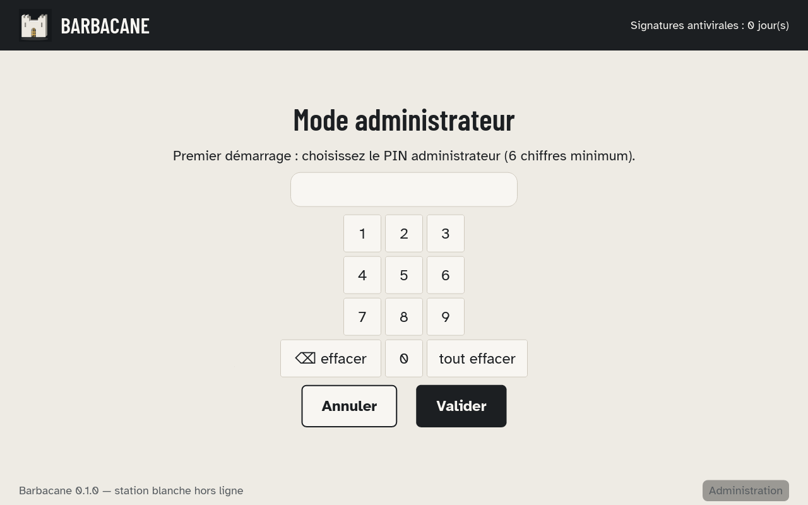

3. Le menu d'administration s'ouvre. **Quitter le mode administrateur** pour revenir à l'accueil.

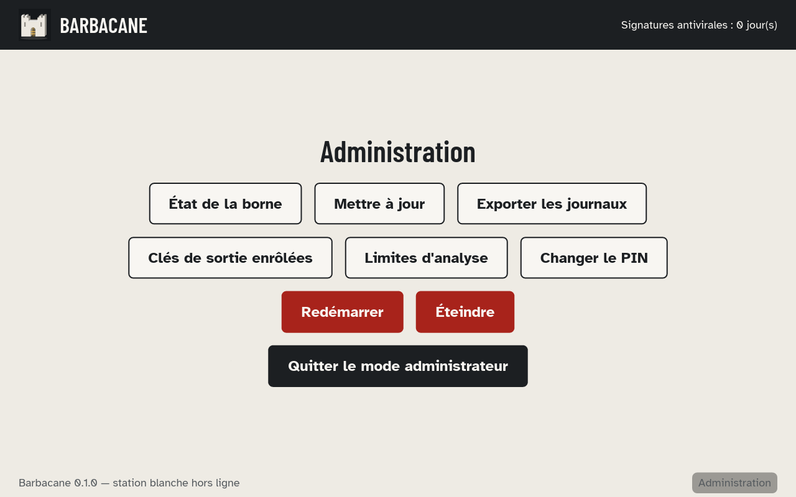

Sécurités du PIN :

- un mauvais PIN est refusé, et l'écran indique les essais restants ;
- après 5 échecs, l'administration est verrouillée 15 minutes, puis 30, 60… Même le bon PIN est
  refusé pendant ce délai ;
- la session administrateur se ferme seule après 15 minutes d'inactivité.

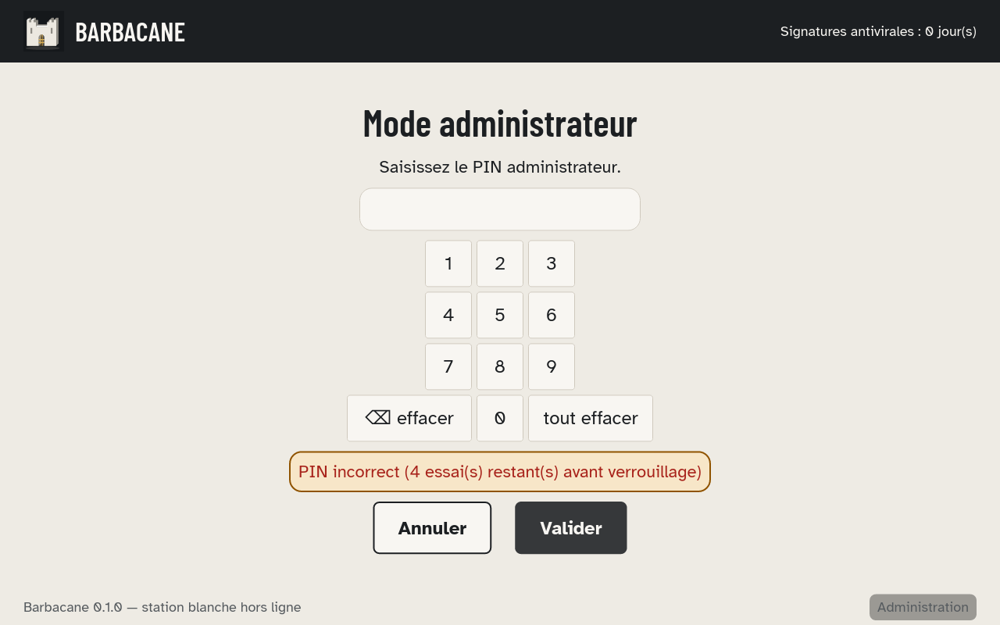

**PIN oublié** : il n'existe volontairement aucune porte dérobée (root verrouillé, aucun pilote
clavier, menu de démarrage protégé par un mot de passe que personne ne connaît). Il faut
**réinstaller** la borne (§3), puis refaire l'enrôlement des clés (§5).

# 5. Gestion des clés de destination

Par défaut, n'importe quelle clé peut servir de destination. Le mode **« clés enrôlées »**
n'accepte en sortie que les clés de la liste : il évite qu'une clé personnelle reçoive des
fichiers. C'est une mesure d'organisation, pas un contrôle d'accès : un numéro de série peut
être copié.

## Enrôler une clé

1. Administration → PIN → **Clés de sortie enrôlées**.
2. Brancher la clé : elle apparaît sous « Enrôler : … ». Cliquer dessus.
3. Cliquer **Activer** pour n'accepter que les clés de la liste.

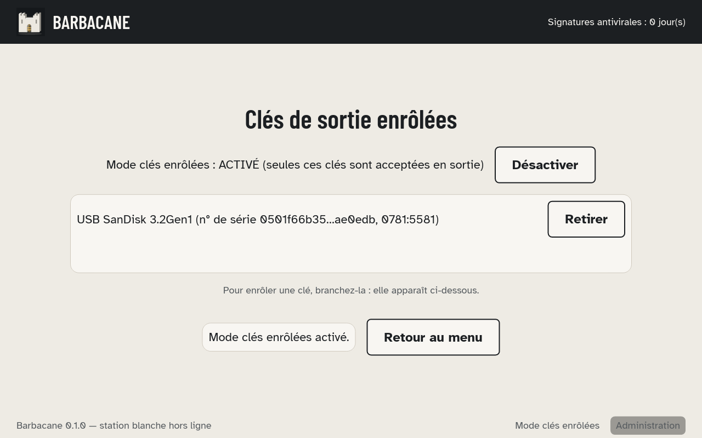

## Retirer une clé, perte d'une clé enrôlée

Sur le même écran, **Retirer** supprime une clé de la liste. Une clé enrôlée perdue doit être
retirée tout de suite. Toute clé non enrôlée est refusée en sortie avec un message :

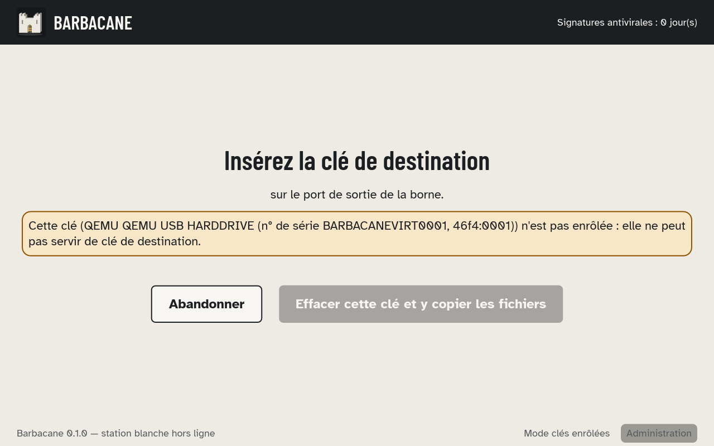

# 6. Utilisation

## Copier vers une clé de destination

1. Brancher la clé à analyser sur le port **ENTRÉE**, cliquer **Copier vers une clé de destination**.

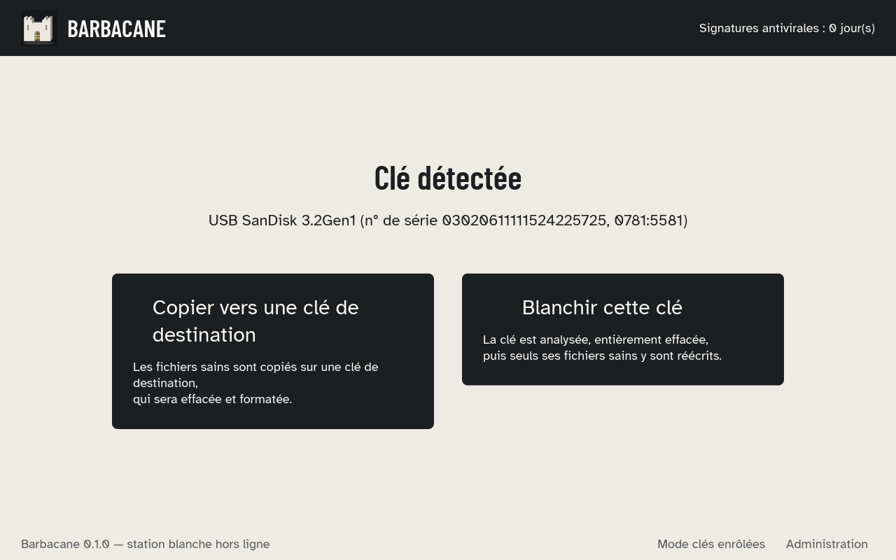

2. Si une archive est protégée par un mot de passe, la borne le demande. Saisir le mot de passe
   au clavier virtuel, ou **Ignorer cette archive**.
3. Le résultat s'affiche : menaces, fichiers écartés et raison de chaque refus.

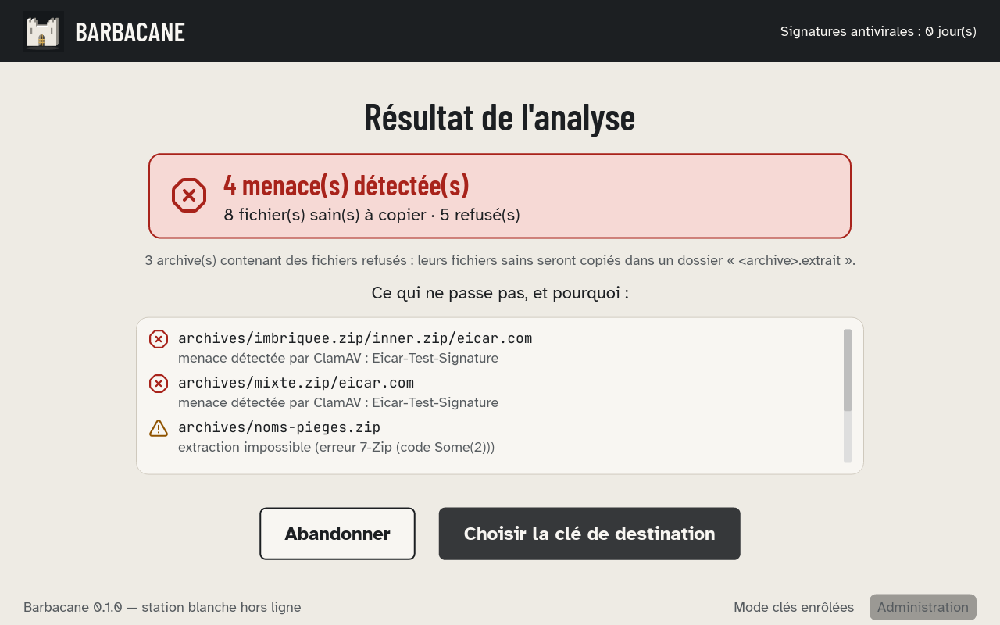

4. **Choisir la clé de destination**, la brancher sur le port **SORTIE**, puis **Effacer cette
   clé et y copier les fichiers**. Le contenu précédent de cette clé est effacé.

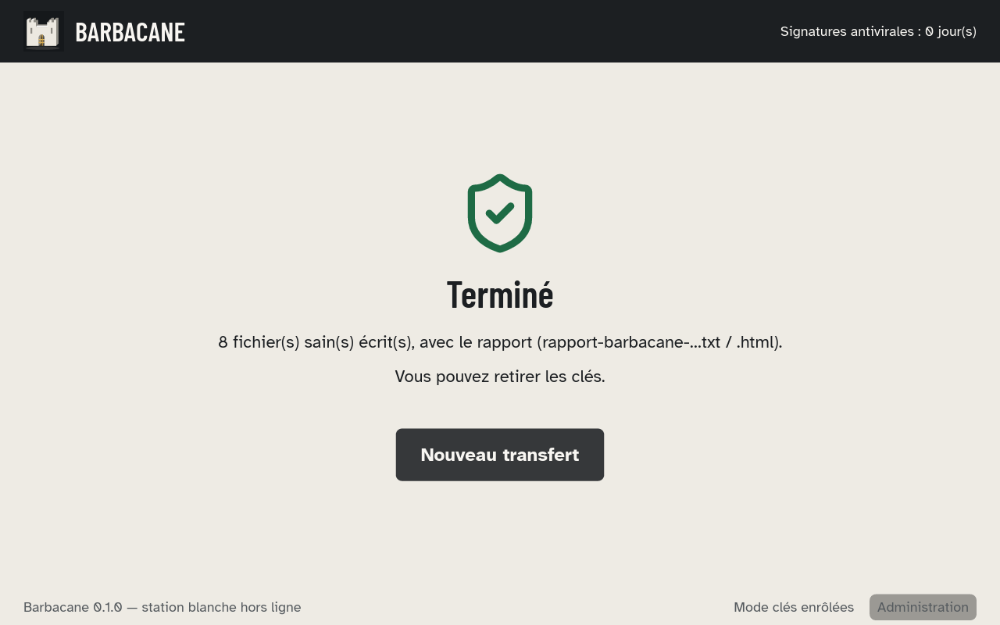

Sur la clé de destination, on trouve :

- les fichiers sains, avec leur arborescence ;
- pour une archive qui contenait une menace : l'archive n'est pas copiée, mais ses fichiers sains
  le sont, dans `<archive>.extrait/` ;
- le rapport `rapport-barbacane-<date>.txt` (et `.html`).

## Blanchir une clé

Le blanchiment nettoie la clé elle-même : analyse, **effacement complet**, puis réécriture des
seuls fichiers sains et du rapport. Pendant l'effacement, l'écran affiche la quantité traitée,
la vitesse de la clé et le temps restant. Une clé lente prend du temps : ne la retirez pas.

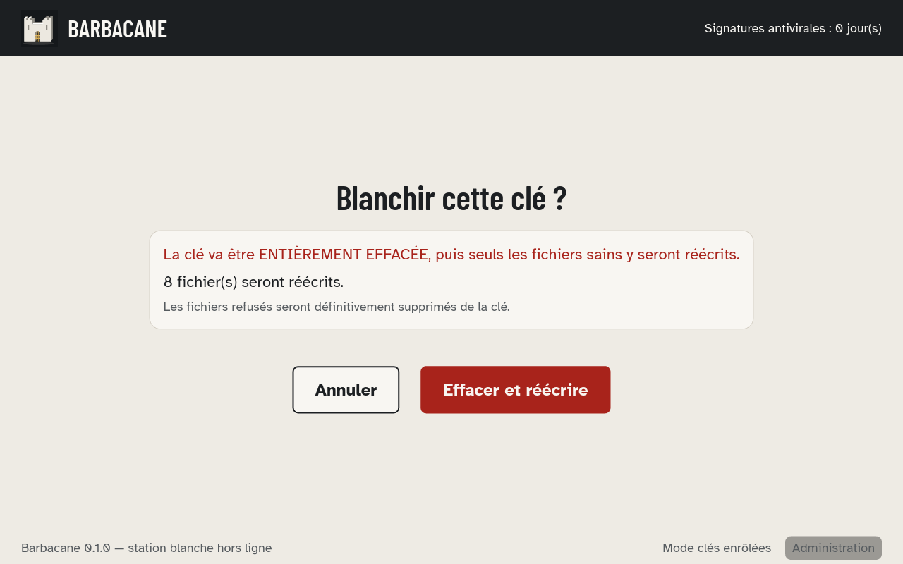

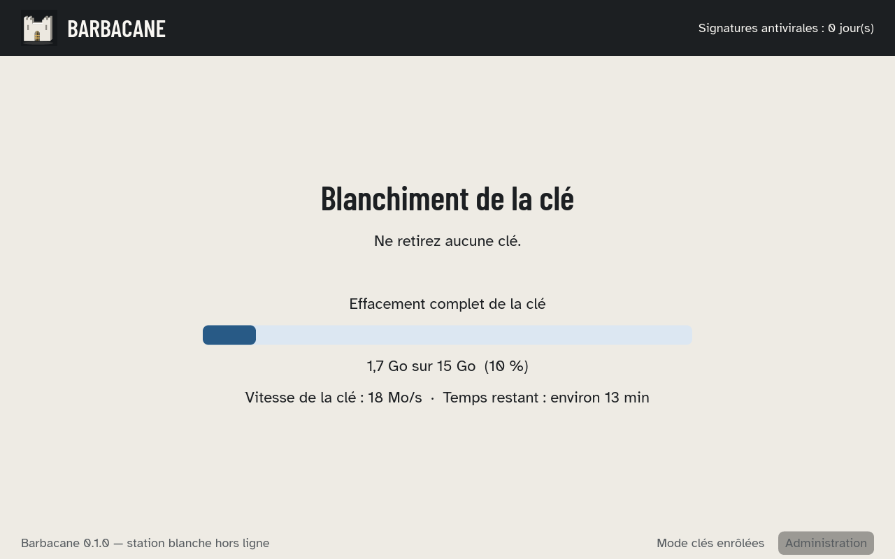

## Disques optiques (CD, DVD, BD)

Le lecteur optique de la borne est une source et une destination comme les ports USB.

- **Disque à analyser** : insérer le disque. L'écran « Disque détecté » propose **Copier vers
  une clé de destination**, **Graver sur un disque** ou **Blanchir ce disque** (disque
  réinscriptible seulement), ou **Ignorer ce disque** (pour utiliser une clé à la place).
  **Toutes les sessions** du disque sont lues : un fichier caché dans une ancienne session
  est analysé comme les autres. Les CD audio et les disques illisibles sont refusés.

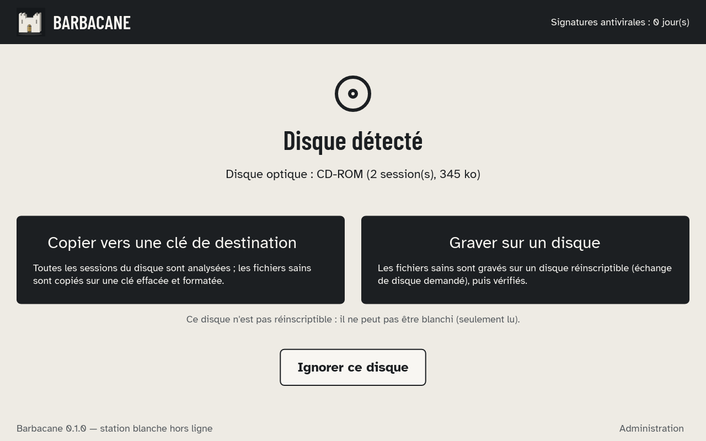

- **Graver sur un disque** (depuis une clé ou un disque) : utiliser un disque
  **réinscriptible** (CD-RW, DVD-RW, DVD+RW, BD-RE). Son contenu est d'abord **entièrement
  effacé**, puis les fichiers sains sont gravés à la vitesse la plus basse que le disque accepte,
  puis **relus et comparés** (empreinte SHA-256 de chaque fichier). Un CD-R, DVD-R ou BD-R est
  refusé avec un message. Avec un seul lecteur, la copie disque → disque demande de retirer le
  disque analysé puis d'insérer le disque de destination.
- **Blanchir ce disque** : analyse, effacement **complet** (jamais l'effacement rapide, qui
  laisse les données lisibles) vérifié par relecture, puis regravure des seuls fichiers sains.
- En mode « clés enrôlées », la gravure sur disque est refusée (seules les clés enrôlées sont
  acceptées en sortie).
- Durées : voir le tableau des mesures dans `docs/preuves/optique/` (un CD-RW se grave et
  s'efface lentement : plusieurs minutes pour quelques centaines de Mo). Ne retirez pas le
  disque pendant l'opération ; la borne l'éjecte à la fin.

## Lire un rapport

Le rapport `.txt` liste chaque fichier : `[COPIÉ]` ou `[REFUSÉ]`, avec la raison (« menace
détectée par ClamAV : … », « archive chiffrée », « nom de fichier dangereux »…). La version
`.html` présente les mêmes informations sous forme de tableau.

# 7. Administration

## Mises à jour signées et base antivirale

Les signatures antivirales vieillissent : l'en-tête de la borne affiche leur âge, et une
alerte apparaît au-delà de 7 jours. Une mise à jour apporte les signatures ClamAV, les règles
YARA et, si besoin, les paquets Debian.

Sur le poste administrateur :

```sh
borne/update/barbacane-update-prepare --cle ~/cles-barbacane/barbacane-maj.key --sortie ./maj
```

Copier `barbacane-maj-<version>.bcu` et `.bcu.minisig` à la racine d'une clé USB. Sur la borne :
Administration → **Mettre à jour** → brancher la clé sur le port ENTRÉE → **Lire et appliquer**.

La borne refuse un paquet non signé, signé par une autre clé, corrompu, ou plus ancien que
la version installée :

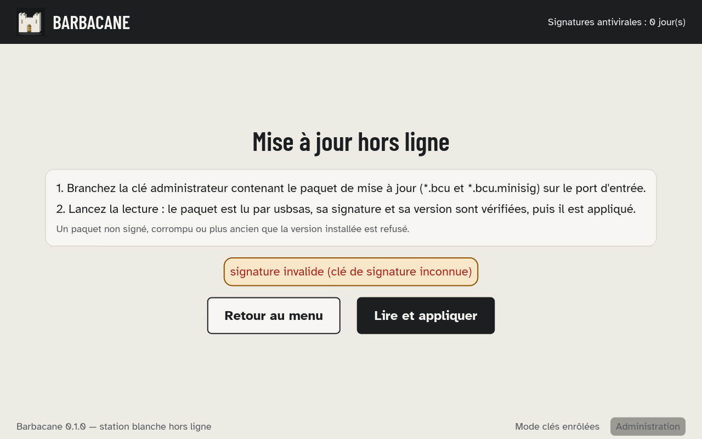

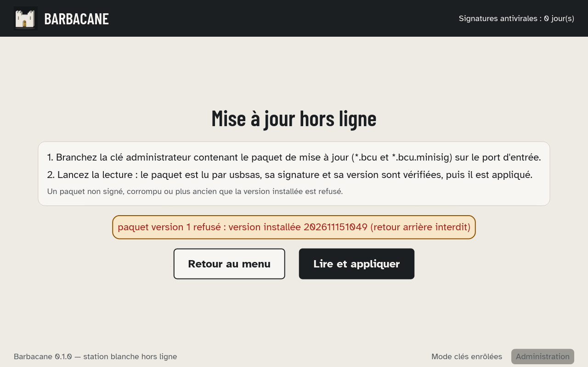

## Rotation de la clé de signature

Générez une nouvelle paire (§2.2, dans un autre dossier), puis préparez un paquet signé avec
l'**ancienne** clé qui transporte la **nouvelle** clé publique :

```sh
borne/update/barbacane-update-prepare --cle ancienne.key --sortie ./maj \
    --nouvelle-cle nouvelle/barbacane-maj.pub
```

Une fois ce paquet appliqué, seule la nouvelle clé est acceptée. Une clé secrète compromise
impose de réinstaller les bornes avec une ISO contenant la nouvelle clé publique.

## Exporter les journaux et rapports

Administration → **Exporter les journaux** → brancher une clé sur le port SORTIE (elle est
effacée) → **Exporter**. La clé reçoit les journaux de la borne, les rapports et l'état des
paquets (`dpkg-status`), utile pour préparer une mise à jour Debian.

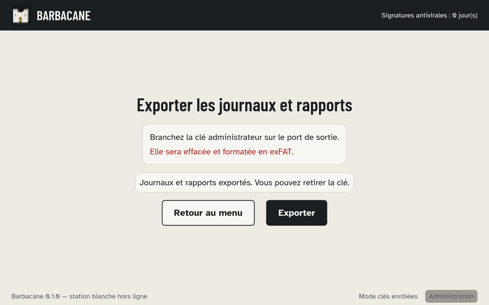

# 8. Dépannage

| Symptôme | Cause probable / action |
|---|---|
| Le poste ne démarre pas sur la clé d'installation | Démarrage USB non autorisé, ou Secure Boot : voir §1. Recopier l'ISO en mode « image DD ». |
| L'installation semble arrêtée | La copie des paquets prend plusieurs minutes. Au-delà de 30 minutes : débrancher les disques en trop et relancer. |
| « Base antivirale absente » ou signatures anciennes | Appliquer une mise à jour signée (§7). |
| « Cette clé n'est pas enrôlée » | Utiliser une clé enrôlée, ou l'enrôler (§5). |
| La copie ou le blanchiment est très long | Clé lente (voir la vitesse affichée) : patienter, ou utiliser une meilleure clé sur un port USB 3. |
| « Une erreur est survenue » pendant l'écriture | La clé a pu être effacée sans être réécrite : ne pas l'utiliser, la laisser branchée et cliquer **Réessayer l'écriture**. |
| Clé retirée trop tôt | Un message d'erreur s'affiche, rien n'est copié : cliquer **Recommencer depuis le début**. |
| Clé illisible ou vide | Un message s'affiche ; la borne reste utilisable. |
| Mise à jour refusée | Lire le message : signature invalide (mauvaise clé ou fichier abîmé) ou version plus ancienne. |
| Écran noir | La borne n'accepte aucun clavier. Démarrer sur une clé Debian « live », monter le disque en lecture seule et lire `journalctl -D /mnt/var/log/journal -u barbacane-kiosk`, ou réinstaller. |
| PIN oublié | Réinstaller la borne (§3 et §5). |
