# 1. Vue d'ensemble

## À qui s'adresse ce manuel

Vous devez installer et faire vivre **Barbacane** : des **bornes** qui vérifient les clés USB
(et les disques optiques) d'origine inconnue, et, si vous le choisissez, un **serveur** qui les
supervise. La borne analyse tous les fichiers (antivirus ClamAV, règles YARA, contenu des
archives) puis :

- **copie** les seuls fichiers sains vers une clé de destination ;
- ou **blanchit** le support : effacement complet, puis réécriture des seuls fichiers sains.

Aucune connaissance du projet n'est nécessaire. Ce manuel correspond à **Barbacane v2.0**.

## Deux façons d'utiliser Barbacane

| | Borne hors ligne seule (v1) | Suite : serveur + bornes en ligne (v2) |
|---|---|---|
| Réseau | **aucun**, jamais | réseau dédié borne → serveur seulement (TLS 1.3 mutuel) |
| ISO de la borne | `build-iso.sh` sans option (identique à la v1.0.0) | `build-iso.sh --profil en-ligne`, ou ISO personnalisée téléchargée depuis le serveur |
| Mises à jour | clé USB, paquet signé | clé USB **ou** diffusées par le serveur (toujours signées hors ligne, revérifiées par la borne) |
| Administration | PIN sur chaque borne | PIN sur chaque borne + interface web du serveur (supervision, enrôlement, utilisateurs, clés USB…) |
| Chapitres | 2 à 9 | 10 à 14 (et 2 à 9 pour l'usage de la borne, qui ne change pas) |

**La borne hors ligne est inchangée** en v2 : son ISO, son parcours et ses écrans sont ceux de la
v1. La borne en ligne garde la même interface ; elle ajoute une page **Serveur** dans
l'administration et, selon le site, un écran d'identification.

```
 site A                                     réseau d'administration
 ┌──────────────┐  TLS 1.3 mutuel           ┌──────────────────────────────┐
 │ borne en     │ ────────────────────────► │ serveur Barbacane            │
 │ ligne        │  enrôlement, battement,   │ disque chiffré (TPM)         │
 └──────────────┘  mises à jour, rapports   │ passerelle · registre        │
 ┌──────────────┐                           │ journal d'audit · web        │
 │ borne hors   │  aucun réseau             └──────────────────────────────┘
 │ ligne (v1)   │                                    ▲ navigateur + certificat
 └──────────────┘                                    │ administrateur
```

Les bornes ne transmettent **jamais de nom de fichier** au serveur : seulement l'empreinte
SHA-256, l'extension, la taille et le verdict.

> **Niveau visé : Diffusion Restreinte.** Barbacane n'est pas homologué : la décision revient à
> l'autorité d'homologation de votre organisme. Les ISO v2.0.0 publiées contiennent une
> **PKI de TEST** : elles servent à l'essai, pas à un site réel (chapitre 14).

Les captures d'écran de ce manuel viennent d'une vraie borne testée avec de vraies clés USB, et du
vrai code de rendu de l'interface web (dossier `docs/preuves` du dépôt).

# Partie A — Borne hors ligne {.partie}

Les chapitres 2 à 9 décrivent la borne **hors ligne**. Ils valent aussi pour la borne en ligne
(même installation, même utilisation), sauf les différences signalées au chapitre 12.

# 2. Matériel nécessaire et réglages BIOS

## Matériel

| Élément | Exigence |
|---|---|
| Poste borne | PC x86_64 (HP ProDesk, Dell OptiPlex…), UEFI, 16 Go de RAM recommandés (8 Go testés), disque interne de 32 Go minimum. **Le disque sera entièrement effacé.** |
| Périphériques | écran + **souris USB**. Pas de clavier : la borne n'en gère aucun. |
| Ports USB | un port « ENTRÉE » (clé à analyser), un port « SORTIE » (clé de destination), un port souris. Préférer des ports USB 3 (bleus) : les clés y sont jusqu'à dix fois plus rapides. |
| Clé d'installation | clé USB de 2 Go minimum (son contenu sera effacé). |
| Poste administrateur | PC sous Debian 13 **connecté à Internet**, droits root, 20 Go libres. Il fabrique l'ISO et signe les mises à jour. Ce n'est jamais la borne. |
| Clés de destination | clés USB de bonne qualité, avec un numéro de série (nécessaire à l'enrôlement). |

## Réglages BIOS / UEFI de la borne

Entrer dans le BIOS (**F10** sur HP, **F2** sur Dell).

Avant l'installation :

1. Mode de démarrage **UEFI**.
2. Autoriser le démarrage sur USB (le temps de l'installation seulement).
3. Désactiver Secure Boot seulement si le poste refuse de démarrer sur la clé.

Après l'installation (§5) :

1. **Démarrage sur le disque interne uniquement** : désactiver USB, réseau (PXE), lecteur optique
   et le menu de démarrage F9/F12.
2. **Mot de passe administrateur BIOS**, conservé avec les secrets de l'administration.
3. Désactiver Wake-on-LAN, Intel AMT/vPro, Wi-Fi, Bluetooth et Thunderbolt si le BIOS le permet.
4. Activer VT-d / IOMMU (protection contre les attaques par accès mémoire direct).
5. **Ne jamais brancher de câble réseau.** Les mises à jour du BIOS se font par clé USB.

# 3. Préparation sur le poste administrateur

Toutes les commandes se tapent **en root** sur le poste administrateur connecté
(`su -` si `sudo` n'est pas installé).

## 3.1 Récupérer Barbacane

```sh
apt-get update && apt-get install -y git minisign
git clone https://github.com/Titouanlvt/Barbacane.git barbacane
cd barbacane
```

## 3.2 Créer la clé de signature des mises à jour

Une seule fois pour tout le parc. Choisissez une phrase de passe solide (demandée deux fois).

```sh
borne/update/barbacane-update-keygen ~/cles-barbacane
```

Deux fichiers sont créés :

- `barbacane-maj.key` : clé **secrète**. Quiconque la détient (avec la phrase de passe) peut
  faire installer n'importe quoi sur les bornes. Gardez-la sur ce poste ou sur une clé USB
  chiffrée rangée au coffre ; **jamais** sur une borne.
- `barbacane-maj.pub` : clé publique, intégrée à l'ISO.

## 3.3 Construire l'ISO

```sh
cp ~/cles-barbacane/barbacane-maj.pub systeme/iso/maj.pub
systeme/iso/build-iso.sh --sortie barbacane.iso      # 30 à 40 minutes
sha256sum barbacane.iso                               # à noter avec la date
```

L'ISO contient tout : Debian 13, Barbacane, la base antivirale du jour. **L'installation ne
demande aucun réseau.** Sans `maj.pub`, aucune mise à jour ne pourra jamais être appliquée.

## 3.4 Copier l'ISO sur une clé USB

Une erreur de cible efface un disque du poste : identifiez la clé **avant** de copier.

```sh
lsblk -d -o NAME,SIZE,TRAN,MODEL,SERIAL
```

La clé est la ligne dont `TRAN` vaut `usb`, avec la taille et le modèle attendus
(ici `/dev/sdX`). Puis :

```sh
dd if=barbacane.iso of=/dev/sdX bs=4M status=progress conv=fsync
cmp -n "$(stat -c %s barbacane.iso)" barbacane.iso /dev/sdX && echo "copie vérifiée"
```

Sous Windows : Rufus en mode **« image DD »**.

# 4. Installation de la borne

1. Brancher la clé d'installation, allumer, choisir la clé dans le menu de démarrage
   (**F9** HP, **F12** Dell).
2. L'installation démarre seule au bout de 10 secondes. **Ne rien toucher.**
   Le plus grand disque interne est effacé (jamais un disque USB).

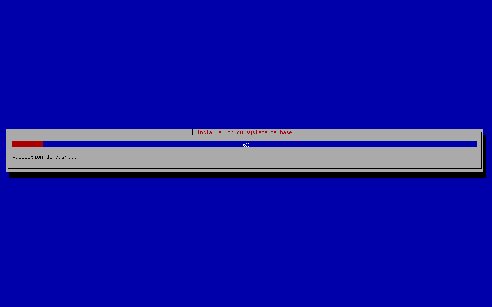

3. Le poste redémarre tout seul (≈ 15 minutes). **Retirer la clé d'installation.**
4. L'écran d'accueil de Barbacane apparaît.

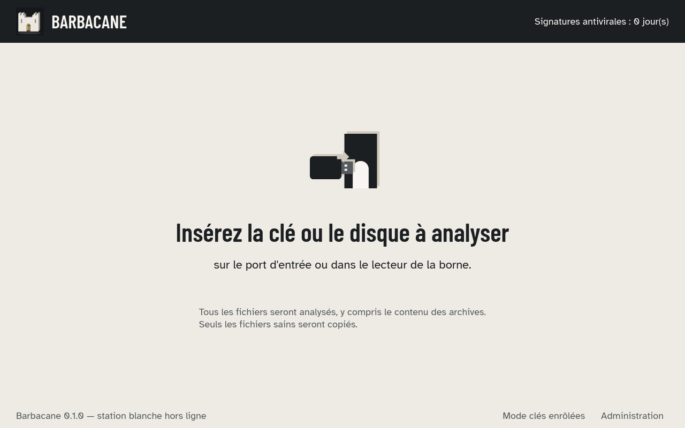

5. Appliquer les réglages BIOS « après l'installation » (§2).

# 5. Premier démarrage et PIN

**Choisissez le PIN immédiatement** : tant qu'aucun PIN n'existe, le premier venu peut le choisir.

1. Cliquer sur **Administration**, en bas à droite.
2. L'écran indique « Premier démarrage : choisissez le PIN administrateur ». Saisir au moins
   6 chiffres sur le pavé, puis **Valider**.

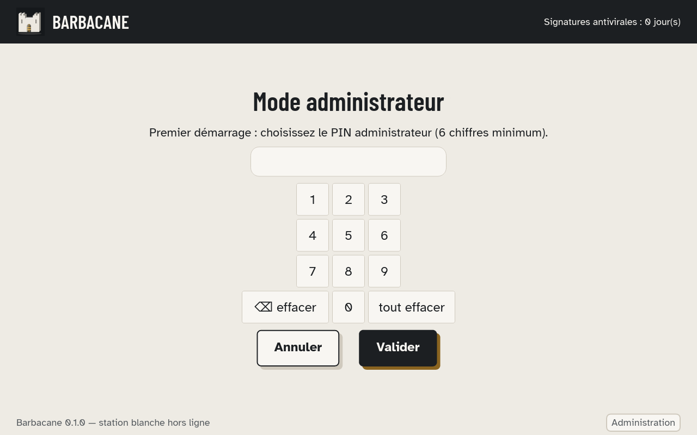

3. Le menu d'administration s'ouvre. **Quitter le mode administrateur** pour revenir à l'accueil.

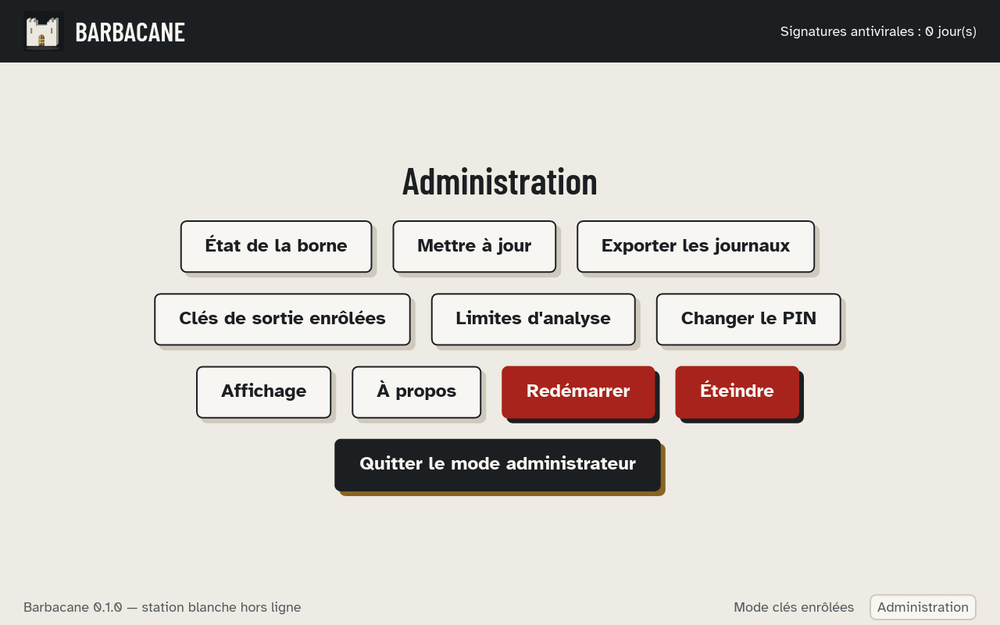

Sécurités du PIN :

- un mauvais PIN est refusé, et l'écran indique les essais restants ;
- après 5 échecs, l'administration est verrouillée 15 minutes, puis 30, 60… Même le bon PIN est
  refusé pendant ce délai ;
- la session administrateur se ferme seule après 15 minutes d'inactivité.

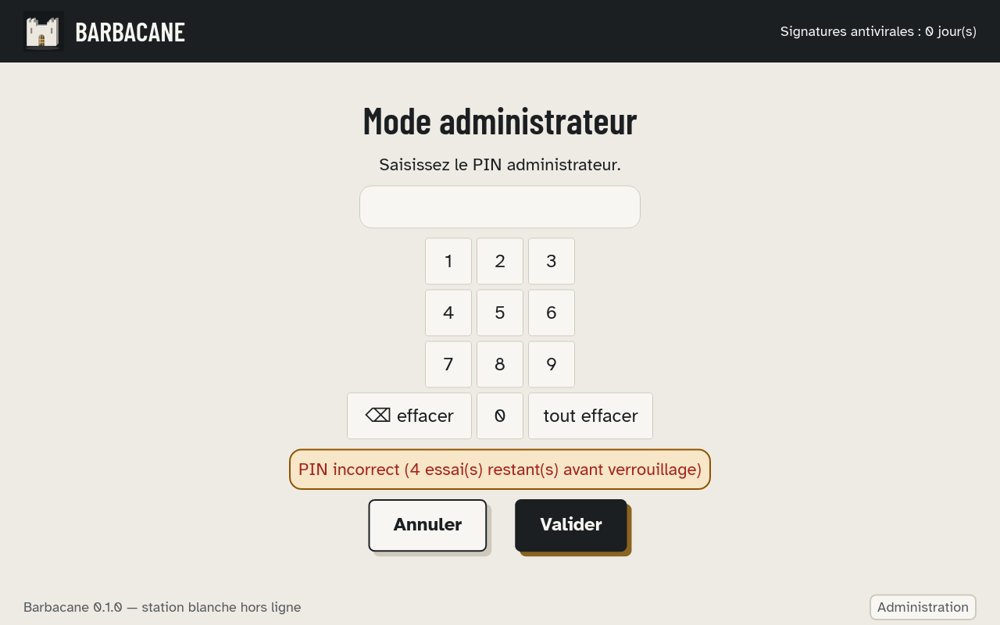

**PIN oublié** : il n'existe volontairement aucune porte dérobée (root verrouillé, aucun pilote
clavier, menu de démarrage protégé par un mot de passe que personne ne connaît). Il faut
**réinstaller** la borne (§4), puis refaire l'enrôlement des clés (§6).

# 6. Gestion des clés de destination

Par défaut, n'importe quelle clé peut servir de destination. Le mode **« clés enrôlées »**
n'accepte en sortie que les clés de la liste : il évite qu'une clé personnelle reçoive des
fichiers. C'est une mesure d'organisation, pas un contrôle d'accès : un numéro de série peut
être copié.

## Enrôler une clé

1. Administration → PIN → **Clés de sortie enrôlées**.
2. Brancher la clé : elle apparaît sous « Enrôler : … ». Cliquer dessus.
3. Cliquer **Activer** pour n'accepter que les clés de la liste.

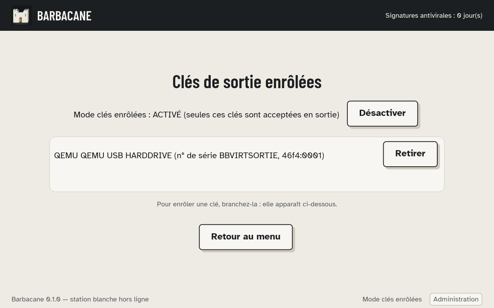

## Retirer une clé, perte d'une clé enrôlée

Sur le même écran, **Retirer** supprime une clé de la liste. Une clé enrôlée perdue doit être
retirée tout de suite. Toute clé non enrôlée est refusée en sortie avec un message :

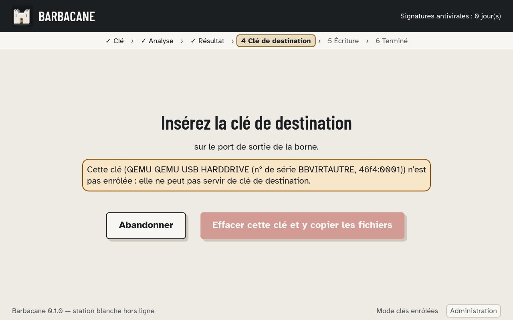

# 7. Utilisation

## Analyser d'abord, décider ensuite

Le parcours est le même pour une clé USB et pour un disque optique : on **analyse** d'abord, sans
rien écrire ; on choisit ensuite, en connaissant le résultat, de **copier vers une clé connue**,
de **graver**, de **blanchir** le support analysé ou d'**arrêter ici**.

1. Brancher la clé à analyser sur le port **ENTRÉE**, cliquer **Analyser**.


2. Si une archive est protégée par un mot de passe, la borne le demande. Saisir le mot de passe
   au clavier virtuel, ou **Ignorer cette archive**.
3. Le résultat s'affiche : menaces, fichiers écartés et raison de chaque refus, puis les choix
   **Arrêter ici**, **Copier vers une clé connue**, **Graver un disque** (si la borne a un
   graveur) et **Blanchir la clé**.

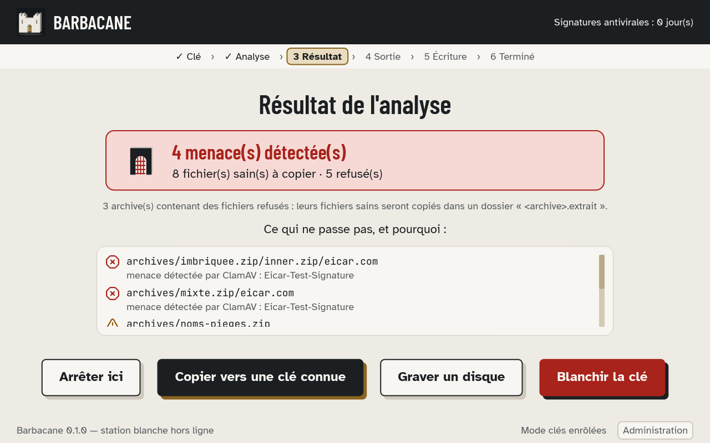

4. **Copier vers une clé connue** : brancher la clé de destination sur le port **SORTIE**, puis **Effacer cette
   clé et y copier les fichiers**. Le contenu précédent de cette clé est effacé.

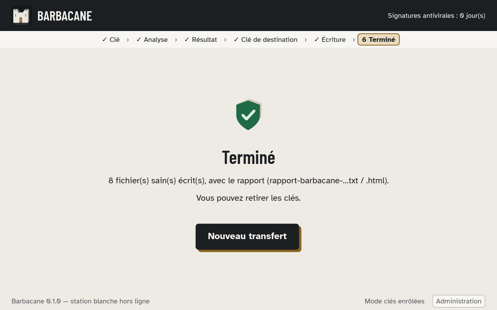

Sur la clé de destination, on trouve :

- les fichiers sains, avec leur arborescence ;
- pour une archive qui contenait une menace : l'archive n'est pas copiée, mais ses fichiers sains
  le sont, dans `<archive>.extrait/` ;
- le rapport `rapport-barbacane-<date>.txt` (et `.html`).

Une analyse a besoin d'environ **3 fois** la taille du contenu sur le disque interne (espace de
travail chiffré, vidé à chaque fin de session). Si la clé est trop volumineuse pour la borne, le
refus s'affiche dès le début, avant toute copie. L'espace disponible est indiqué dans
Administration → État de la borne.

## Blanchir une clé

Choix **Blanchir la clé** sur l'écran de résultat. Le blanchiment nettoie la clé elle-même : analyse, **effacement complet**, puis réécriture des
seuls fichiers sains et du rapport. Pour confirmer, gardez le bouton **Maintenir pour effacer**
enfoncé 2 secondes : un voile le remplit, et le relâcher avant la fin annule (rien n'est effacé).
Pendant l'effacement, l'écran affiche la quantité traitée, la vitesse de la clé, le temps restant
et un chronomètre ; la barre reste animée même si un gros fichier la bloque. Une clé lente prend
du temps : ne la retirez pas.

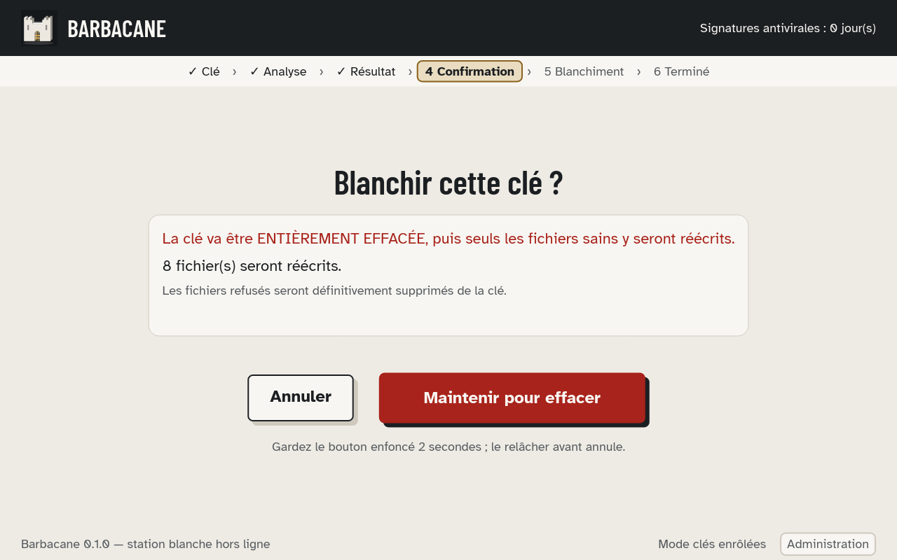

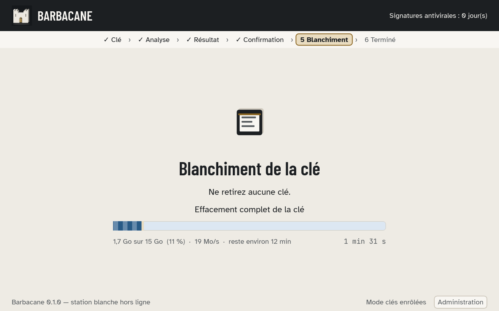

## Clés démarrables (Ventoy, Rufus, Etcher)

La partie « démarrage » d'une clé (secteur 0, chargeur EFI) ne peut pas être analysée comme un
fichier. La borne ne la recopie donc **jamais**.

- **Clé Ventoy** : l'écran de résultat propose en plus **Blanchir en gardant démarrable**. La
  borne efface la clé, réinstalle la version de Ventoy **embarquée dans la borne** (vérifiée à la
  construction de l'ISO), puis recopie seulement les images saines. Le dossier `ventoy/`
  (configuration, greffons) n'est pas recopié. La clé démarre ensuite comme avant.

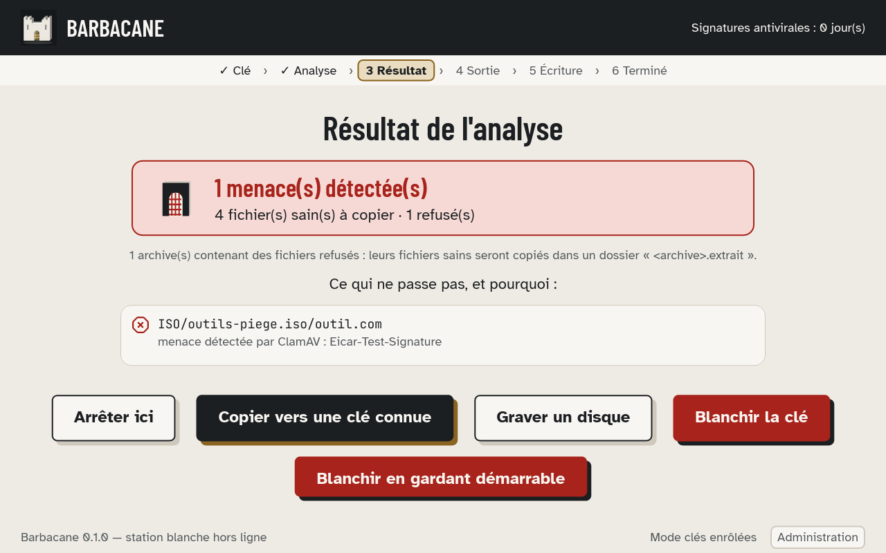

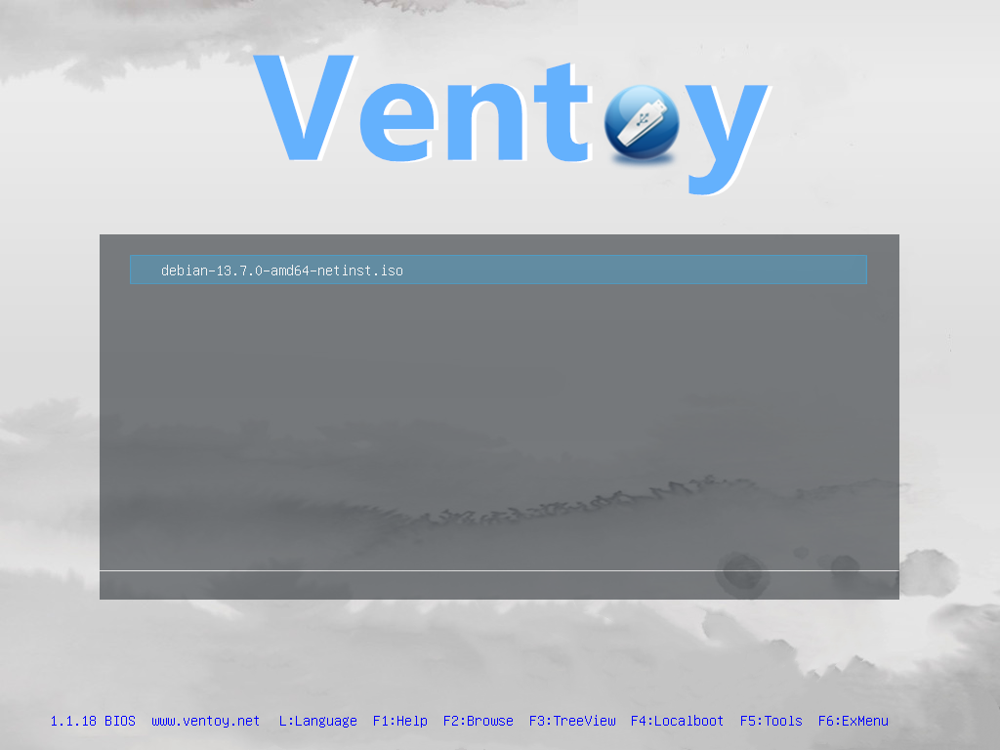

- **Clé Rufus ou Etcher** : un avertissement s'affiche. **Blanchir en gardant démarrable** relit
  l'image de la clé ; si c'est une image officielle de la **liste blanche** (déclarée par
  l'administrateur, mise à jour signée), la clé est effacée puis l'image réécrite à l'identique et la
  clé reste démarrable (preuve : `docs/preuves/etcher/`) ; sinon, rien n'est modifié. **Blanchir la
  clé** la rend non démarrable : recréez-la depuis une image officielle, ou copiez l'image (ISO)
  saine sur une clé Ventoy.

## Disques optiques (CD, DVD, BD)

Le lecteur optique de la borne est une source et une destination comme les ports USB.

- **Disque à analyser** : insérer le disque. L'écran « Disque détecté » propose **Analyser**, ou
  **Ignorer ce disque** (pour utiliser une clé à la place) ; après l'analyse : **Copier vers une
  clé connue**, **Graver un disque** ou **Blanchir le disque** (réinscriptible seulement).
  **Toutes les sessions** du disque sont lues : un fichier caché dans une ancienne session
  est analysé comme les autres. Les CD audio et les disques illisibles sont refusés.

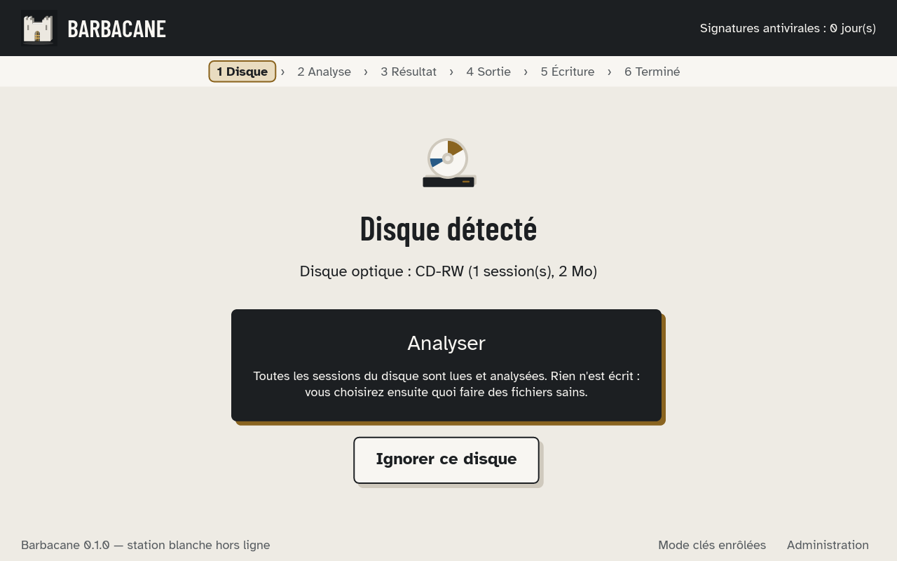

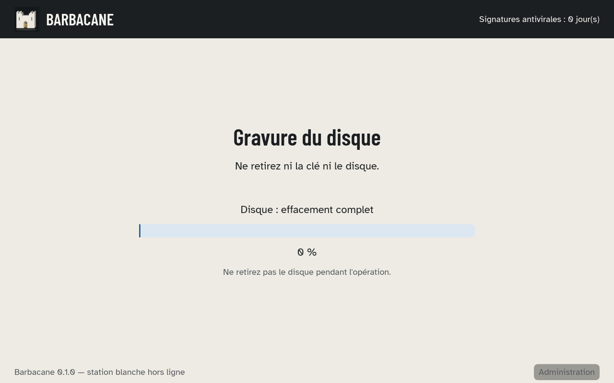

- **Graver un disque** (depuis une clé ou un disque) : utiliser un disque
  **réinscriptible** (CD-RW, DVD-RW, DVD+RW, BD-RE). Son contenu est d'abord **entièrement
  effacé**, puis les fichiers sains sont gravés à la vitesse la plus basse que le disque accepte,
  puis **relus et comparés** (empreinte SHA-256 de chaque fichier). Un CD-R, DVD-R ou BD-R est
  refusé avec un message. Avec un seul lecteur, la copie disque → disque demande de retirer le
  disque analysé puis d'insérer le disque de destination.
- **Blanchir le disque** : analyse, effacement **complet** (jamais l'effacement rapide, qui
  laisse les données lisibles) vérifié par relecture, puis regravure des seuls fichiers sains.
- En mode « clés enrôlées », la gravure sur disque est refusée (seules les clés enrôlées sont
  acceptées en sortie).
- Durées mesurées sur un CD-RW (lecteur portable) : lecture d'un disque, 15 s environ ;
  effacement complet, 9 min ; gravure complète (effacement, gravure, relecture), 10 min ;
  blanchiment de 190 Mo, 15 min. Ne retirez pas le disque pendant l'opération.
- La borne **éjecte** le disque à la fin. Un lecteur portable (tiroir sans moteur) doit être
  refermé à la main avant d'insérer ou de réinsérer un disque.

## Lire un rapport

Le rapport `.txt` liste chaque fichier : `[COPIÉ]` ou `[REFUSÉ]`, avec la raison (« menace
détectée par ClamAV : … », « archive chiffrée », « nom de fichier dangereux »…). La version
`.html` présente les mêmes informations sous forme de tableau.

# 8. Administration

## Mises à jour signées et base antivirale

Les signatures antivirales vieillissent : l'en-tête de la borne affiche leur âge, et une
alerte apparaît au-delà de 7 jours. Une mise à jour apporte les signatures ClamAV, les règles
YARA et, si besoin, les paquets Debian.

Sur le poste administrateur :

```sh
borne/update/barbacane-update-prepare --cle ~/cles-barbacane/barbacane-maj.key --sortie ./maj
```

Copier `barbacane-maj-<version>.bcu` et `.bcu.minisig` à la racine d'une clé USB. Sur la borne :
Administration → **Mettre à jour** → brancher la clé sur le port ENTRÉE → **Lire et appliquer**.

Quand le paquet contient des paquets Debian (nouvelle version de Barbacane, `--debs` ou
`--etat-borne`), le rapport se termine par **« Redémarrage nécessaire »** : revenir au menu,
**Redémarrer**, **Confirmer**. La borne redémarre sur la nouvelle version (vérifié le 18/11/2026,
`preuves/2026-11-18-maj-paquets/`).

> **Bornes installées avant le 18/11/2026** : leur service d'administration ne sait pas installer
> de paquets Debian (erreur `Pathname to install is not absolute`, ou borne qui ne redémarre plus).
> Les mettre à jour en les **réinstallant depuis une ISO récente** ; les mises à jour de signatures
> et de règles YARA, elles, fonctionnent.

La borne refuse un paquet non signé, signé par une autre clé, corrompu, ou plus ancien que
la version installée :

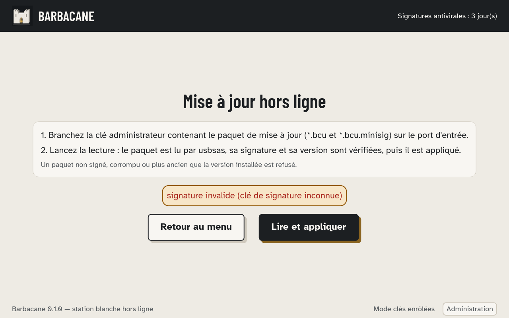

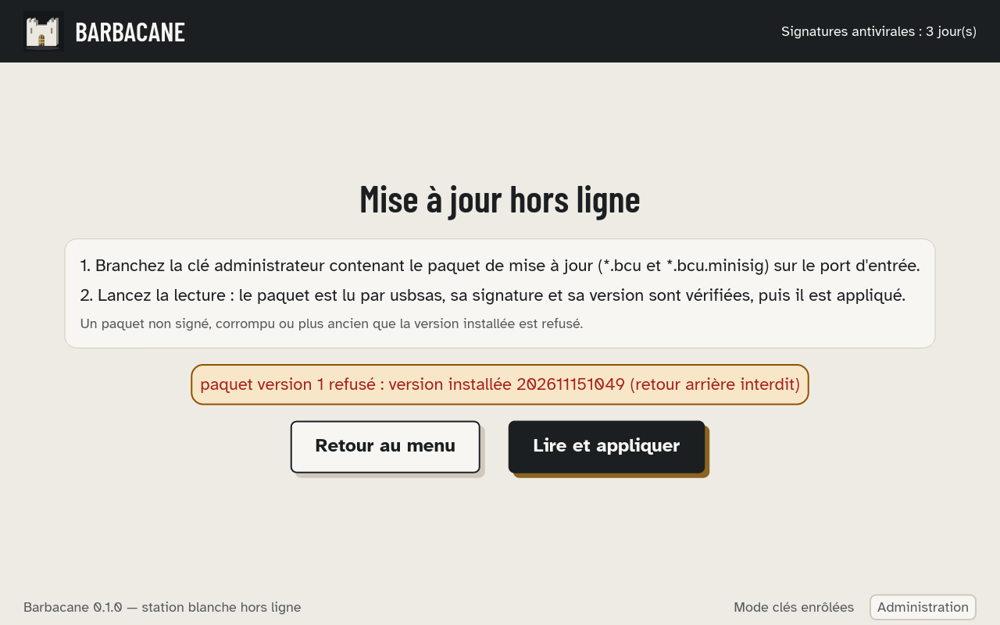

### Images officielles (ISO Windows, Debian…)

Une ISO d'installation Windows contient plus d'un million de fichiers : trop pour être ouverte
sur la borne, elle est refusée. L'administrateur peut déclarer les images qu'il a téléchargées
chez l'éditeur ; la borne les reconnaît alors par leur empreinte et les copie **intactes**, sans
les ouvrir :

```sh
sha256sum Win11_26H2_French_x64.iso > images-officielles.sha256
borne/update/barbacane-update-prepare --cle ~/cles-barbacane/barbacane-maj.key --sortie ./maj \
    --images-officielles images-officielles.sha256
```

La liste n'entre sur la borne que dans un paquet **signé** (preuve : `preuves/liste-blanche/`).

## Rotation de la clé de signature

Générez une nouvelle paire (§3.2, dans un autre dossier), puis préparez un paquet signé avec
l'**ancienne** clé qui transporte la **nouvelle** clé publique :

```sh
borne/update/barbacane-update-prepare --cle ancienne.key --sortie ./maj \
    --nouvelle-cle nouvelle/barbacane-maj.pub
```

Une fois ce paquet appliqué, seule la nouvelle clé est acceptée. Une clé secrète compromise
impose de réinstaller les bornes avec une ISO contenant la nouvelle clé publique.

## Exporter les journaux et rapports

Administration → **Exporter les journaux** → brancher une clé sur le port SORTIE (elle est
effacée) → **Exporter**. La clé reçoit les journaux de la borne, les rapports et l'état des
paquets (`dpkg-status`), utile pour préparer une mise à jour Debian.

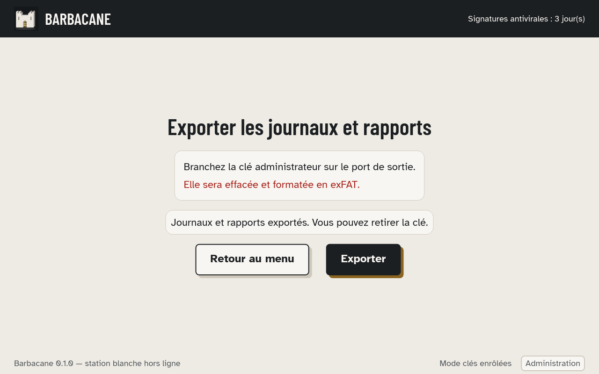

# 9. Dépannage

| Symptôme | Cause probable / action |
|---|---|
| Le poste ne démarre pas sur la clé d'installation | Démarrage USB non autorisé, ou Secure Boot : voir §2. Recopier l'ISO en mode « image DD ». |
| L'installation semble arrêtée | La copie des paquets prend plusieurs minutes. Au-delà de 30 minutes : débrancher les disques en trop et relancer. |
| « Base antivirale absente » ou signatures anciennes | Appliquer une mise à jour signée (§8). |
| « Cette clé n'est pas enrôlée » | Utiliser une clé enrôlée, ou l'enrôler (§6). |
| La copie ou le blanchiment est très long | Clé lente (voir la vitesse affichée) : patienter, ou utiliser une meilleure clé sur un port USB 3. |
| « Une erreur est survenue » pendant l'écriture | La clé a pu être effacée sans être réécrite : ne pas l'utiliser, la laisser branchée et cliquer **Réessayer l'écriture**. |
| Clé retirée trop tôt | Un message d'erreur s'affiche, rien n'est copié : cliquer **Recommencer depuis le début**. |
| Clé illisible ou vide | Un message s'affiche ; la borne reste utilisable. |
| Mise à jour refusée | Lire le message : signature invalide (mauvaise clé ou fichier abîmé) ou version plus ancienne. |
| Écran noir | La borne n'accepte aucun clavier. Démarrer sur une clé Debian « live », monter le disque en lecture seule et lire `journalctl -D /mnt/var/log/journal -u barbacane-kiosk`, ou réinstaller. |
| PIN oublié | Réinstaller la borne (§4 et §6). |

# Partie B — Serveur et bornes en ligne {.partie}

Les chapitres 10 à 13 décrivent la **suite v2** : le serveur, son interface web et les bornes
en ligne. Le chapitre 14 résume la sécurité et les limites.

# 10. Le serveur

## 10.1 Matériel et réseau

| Élément | Exigence |
|---|---|
| Serveur | PC ou serveur x86_64, UEFI, **TPM 2.0 actif** (obligatoire : sans TPM, l'installation s'arrête). Démarrage sécurisé conseillé. **Le disque interne est entièrement effacé.** |
| Interfaces réseau | **deux** cartes : une sur le réseau **des bornes**, une sur le réseau **d'administration**. Aucune route par défaut : le serveur n'est relié à rien d'autre. |
| Poste de construction | PC Debian 13 connecté à Internet (pendant la construction seulement), root. |
| Poste d'administration | navigateur, avec le **certificat d'administrateur** installé, sur le réseau d'administration. |
| Clé d'installation | clé USB (taille de l'ISO + marge) ; copie comme au §3.4. |
| Support de sauvegarde | support amovible (clé, disque USB). |

Le pare-feu du serveur n'accepte que : les deux ports de la passerelle (service et enrôlement)
sur l'interface **bornes** ; le port de l'interface web (443 par défaut) sur l'interface
**administration**. Tout le reste est refusé et journalisé. Aucun accès SSH : l'administration
système se fait **à la console**.

Réglages du micrologiciel après l'installation : mot de passe administrateur, démarrage sur le
disque interne seulement, démarrage USB désactivé, local protégé. Le déverrouillage TPM est lié
à l'état du démarrage sécurisé (PCR 7) : ces réglages empêchent un autre système signé de
démarrer à sa place.

## 10.2 Construire les ISO

L'ISO du serveur **embarque les ISO des bornes** de la même version : le serveur peut ensuite
produire lui-même une ISO personnalisée par site (§12.2). On construit donc d'abord les deux ISO
de borne, sur le poste de construction, puis celle du serveur.

**1. ISO des bornes.** L'ISO en ligne connaît l'adresse du serveur et ses deux ports ; ils sont
figés dans l'ISO.

```sh
cp ~/cles-barbacane/barbacane-maj.pub systeme/iso/maj.pub
systeme/iso/build-iso.sh --sortie barbacane-hors-ligne.iso
systeme/iso/build-iso.sh --profil en-ligne --sortie barbacane-en-ligne.iso \
    --ca-serveur ca-serveur.pem --serveur 10.20.0.1 \
    --port-service 43117 --port-enrolement 43118 [--reseau dhcp]
sha256sum barbacane-hors-ligne.iso barbacane-en-ligne.iso > SHA256SUMS
```

- `--ca-serveur` : certificat de la CA « serveur » (issu de la cérémonie PKI) ; c'est la seule
  ancre de confiance de la borne.
- `--serveur` : adresse **IPv4** du serveur sur le réseau des bornes (la borne n'a pas de DNS).
- `--reseau dhcp` (défaut) : une seule ISO pour tout le site ; ou `--reseau 10.30.0.21/24
  --routeur 10.30.0.1` : adresse fixe, une ISO par borne.
- **Imprimez** le fichier `SHA256SUMS` (note de version) : ces empreintes seront comparées plus
  tard, sur le serveur, à celles affichées par la page « ISO des bornes ».

**2. ISO du serveur** (`serveur/iso/build-iso-serveur.sh`, en root, 20 à 40 minutes) :

```sh
serveur/iso/build-iso-serveur.sh --sortie barbacane-serveur.iso \
    --if-bornes enp1s0 --ip-bornes 10.20.0.1/24 \
    --if-admin enp2s0  --ip-admin 10.99.0.1/24 \
    --port 43117 --port-enrolement 43118 \
    --iso-borne-en-ligne barbacane-en-ligne.iso \
    --iso-borne-hors-ligne barbacane-hors-ligne.iso --sha256-bornes SHA256SUMS
sha256sum barbacane-serveur.iso
```

| Option | Rôle (défaut) |
|---|---|
| `--if-bornes NOM`, `--ip-bornes CIDR` | interface et adresse du réseau des bornes (`enp0s8`, `10.20.0.1/24`) |
| `--if-admin NOM`, `--ip-admin CIDR` | interface et adresse d'administration (`enp0s9`, `10.99.0.1/24`) |
| `--port-admin N` | port de l'interface web, côté administration seulement (443) |
| `--port N`, `--port-enrolement N` | ports **fixes** de la passerelle (service, enrôlement). Sans ISO de bornes : tirés au hasard à l'installation. Avec ISO de bornes : **obligatoires** et égaux à ceux de l'ISO en ligne (contrôlé, refus sinon) |
| `--source-heure IP` | serveur NTP **interne** du réseau d'administration (aucun par défaut) |
| `--compte-admin NOM` | compte d'administration système (`barbadmin`) |
| `--hache-admin FICHIER` | empreinte crypt(3) de son mot de passe initial ; sinon mot de passe aléatoire **affiché une seule fois** à la construction |
| `--iso-borne-en-ligne ISO`, `--iso-borne-hors-ligne ISO`, `--sha256-bornes FICHIER` | ISO des bornes embarquées (les trois ensemble) ; refus si une empreinte manque au fichier, si l'ISO en ligne est déjà personnalisée… |
| `--cle-maj-bornes PUB` | clé **publique** des mises à jour des bornes (`barbacane-maj.pub`), nécessaire pour déposer des `.bcu` sur le serveur ; peut être déposée plus tard (**v2.0.1**) |
| `--pki-test DOSSIER`, `--mdp-web FICHIER` | **ISO de TEST seulement** : embarque la PKI de test et le compte web `admin-01` (`--mdp-web` : **v2.0.1**) |
| `--netinst ISO`, `--paquets DOSSIER`, `--passerelle BIN` | fournir une netinst Debian 13, des paquets ou des binaires déjà prêts |
| `--console-serie`, `--verbeux` | banc de test (console série) ; détail à l'écran |

Les noms d'interfaces sont ceux du **système installé** (`ip link` depuis une Debian « live » sur
le serveur). Une interface mal nommée est signalée à chaque démarrage par l'état du serveur.

::: v201
**Nécessite v2.0.1.** L'ISO serveur v2.0.0 n'installe que la passerelle : ni l'interface web, ni
les outils `barbacane-registre` et `barbacane-audit`. Les §10.3 à 13 décrivent le comportement
corrigé de la v2.0.1 (interface web déployée par l'ISO, options `--cle-maj-bornes` et
`--mdp-web`). Construisez le serveur depuis une version 2.0.1 ou ultérieure.
:::

## 10.3 Installer le serveur

1. Copier l'ISO sur une clé (§3.4), démarrer le serveur dessus (TPM 2.0 actif).
2. L'installation est **automatique et sans réseau** (environ 5 minutes) : le plus grand disque
   interne est effacé et chiffré (LUKS2, AES-256), puis la clé du disque est **scellée dans le
   TPM**. Sans TPM, l'installation s'arrête.
3. Retirer la clé ; le serveur redémarre.

## 10.4 Premier démarrage : TPM, clé de secours, comptes

- **Déverrouillage** : le disque s'ouvre seul grâce au TPM, sans rien saisir. S'il demande une
  clé (TPM effacé, carte mère changée, démarrage sécurisé modifié), seule la **clé de secours**
  l'ouvre.
- À la console, se connecter avec le compte d'administration (`barbadmin`) : le mot de passe
  initial est **expiré**, il faut en choisir un nouveau.
- Lire l'état du serveur (`barbacane-serveur-etat`, aussi affiché à chaque démarrage) : disque,
  routes, pare-feu, ports, heure, services.
- **Clé de secours** : elle est écrite dans `/root/cle-de-secours-luks.txt`. La transcrire et la
  ranger au coffre, puis la détruire sur le disque :

```sh
sudo cat /root/cle-de-secours-luks.txt      # à recopier, puis ranger au coffre
sudo shred -u /root/cle-de-secours-luks.txt
```

  Tant qu'elle est sur le disque, l'état du serveur le rappelle à chaque démarrage.
- **Heure** : le serveur est la référence d'heure des bornes. Sans source interne
  (`--source-heure`), la régler à la main : `sudo date -s "AAAA-MM-JJ HH:MM:SS"` puis
  `sudo hwclock -w`.

## 10.5 PKI et premier administrateur web

La passerelle et l'interface web ne démarrent qu'une fois la PKI en place (sans elle, c'est une
« condition non remplie », pas une panne). En **production**, la PKI vient de la **cérémonie**
(racine hors ligne, chapitre 14) ; aucun compte web n'existe par défaut.

1. Déposer la PKI issue de la cérémonie dans `~barbacane-svc/pki/`, puis démarrer la passerelle.
2. Interface web (**v2.0.1**) : déposer `ca-administrateurs.pem` et `crl-administrateurs.pem`
   dans `~barbacane-svc/web/` (lecture seule, 0444), puis créer le premier compte, lié au
   certificat de cet administrateur (le mot de passe, 12 caractères au moins, est lu au clavier) :

```sh
/usr/local/lib/barbacane-serveur/barbacane-web compte IDENTIFIANT administrateur CERT.pem \
    > ~barbacane-svc/web/comptes      # 0600, propriétaire barbacane-svc
systemctl --user -M barbacane-svc@ start barbacane-web
```

**ISO de TEST** (`--pki-test`) : la PKI de test et un compte `admin-01` lié au certificat
`administrateurs/admin-01.cert.pem` sont déjà installés.

> La **CRL des administrateurs** doit être republiée avant son échéance : sinon plus aucune
> connexion n'est acceptée (sécurité par défaut).

## 10.6 Se connecter à l'interface web

::: v201
**Nécessite v2.0.1.** Avec l'ISO serveur v2.0.0, l'interface web n'est pas installée sur le serveur.
:::

1. Installer le **certificat d'administrateur** (et sa clé) dans le navigateur du poste
   d'administration, de préférence sur carte à puce.
2. Ouvrir `https://ADRESSE-ADMIN/` (par exemple `https://10.99.0.1/`). Sans certificat valide,
   la connexion est refusée avant toute page.
3. Saisir l'identifiant et le mot de passe. Le compte est lié à **son** certificat : le bon mot de
   passe avec le certificat d'un autre est refusé.

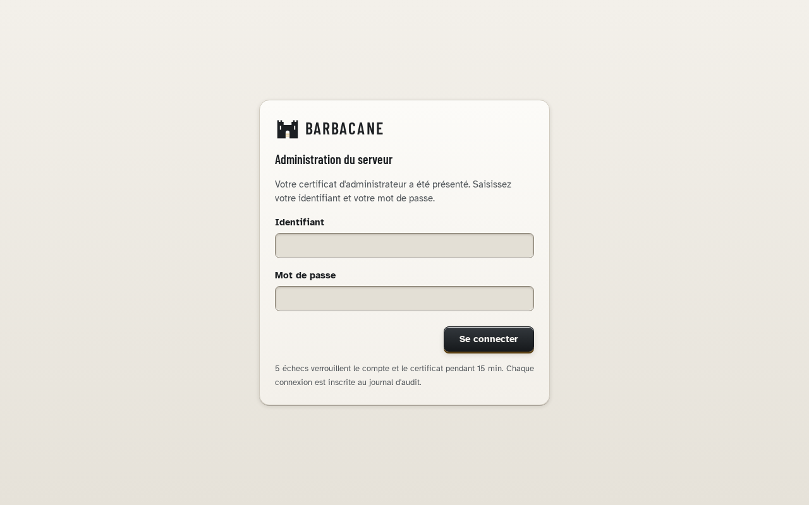

- 5 échecs → compte verrouillé 15 minutes, doublé à chaque nouvel échec ; le message ne dit
  jamais pourquoi.
- Session fermée après **15 minutes** d'inactivité et **8 heures** au plus ; une seule session
  par compte.
- L'interface n'utilise aucun JavaScript et ne charge rien d'extérieur.

| Rôle | Droits |
|---|---|
| `administrateur` | tout : jetons, enrôlement, révocation, mises à jour, utilisateurs, sites, clés USB, ISO des bornes, quarantaine |
| `auditeur` | **lecture seule** : supervision, demandes, mises à jour, journal d'audit et sa vérification, utilisateurs (identifiants en clair). Toute action est refusée. |

Un autre compte se crée avec la même commande `barbacane-web compte` (rôle `administrateur` ou
`auditeur`), ligne ajoutée au fichier `comptes`. Retirer la ligne ferme aussitôt ses sessions.

## 10.7 Journal d'audit

Chaque action (connexion, jeton, validation, révocation, dépôt, consultation…) est écrite dans un
**journal chaîné** (SHA-384) : une ligne modifiée, supprimée ou déplacée est détectée. Page
**Journal d'audit** → **Vérifier** : contrôle de toute la chaîne.

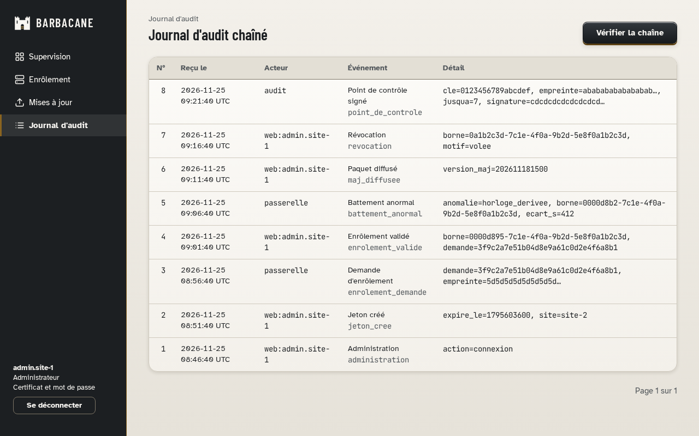

En ligne de commande (console, **v2.0.1**) : `sudo barbacane-audit sceller …` ajoute un point de
contrôle signé, `sudo barbacane-audit exporter …` produit le fichier d'empreintes à **sortir du
serveur** (support non réinscriptible). Le scellement et l'export automatiques sont prévus en
v2.1.0 : faites-les à la main régulièrement.

## 10.8 Sauvegarde et restauration

La sauvegarde (`barbacane-sauvegarde`) est **chiffrée** pour une clé qui reste au coffre (le
serveur ne peut pas relire ses propres sauvegardes) et **signée** par le serveur.

1. Une fois, sur un poste **hors ligne** : créer la clé de sauvegarde (protégée par une phrase de
   passe) et garder la partie privée au coffre :

```sh
barbacane-sauvegarde cles-destinataire DOSSIER
```

2. Déposer le certificat `destinataire.pem` dans `/etc/barbacane-serveur/sauvegarde/` et noter,
   hors du serveur, l'empreinte du certificat de signature du serveur.
3. Sauvegarder vers un support amovible monté (refus si le dossier est sur le disque système) :

```sh
sudo barbacane-sauvegarde creer --destination /media/sauvegarde --garder 14
```

4. Vérifier ou restaurer, avec la clé privée sortie du coffre et le certificat de signature
   consigné :

```sh
barbacane-sauvegarde verifier  --archive FICHIER --cle-privee CLE --signataire CERT
barbacane-sauvegarde restaurer --archive FICHIER --cle-privee CLE --signataire CERT
```

La restauration contrôle tout (empreinte, déchiffrement, signature, manifeste) **avant** d'écrire.
La sauvegarde planifiée est prévue en v2.1.0 : lancez-la à la main.

# 11. Interface web au quotidien

::: v201
**Nécessite v2.0.1.** Toutes les pages de ce chapitre sont servies par l'interface web, déployée par l'ISO serveur à partir de la v2.0.1.
:::

## 11.1 Supervision

Page d'accueil après connexion : tuiles (bornes actives, en service, injoignables, horloge
dérivée, demandes en attente), liste **« À traiter »**, puis une ligne par borne : état, site,
version, dernier contact, écart d'horloge, échéance du certificat, alertes.

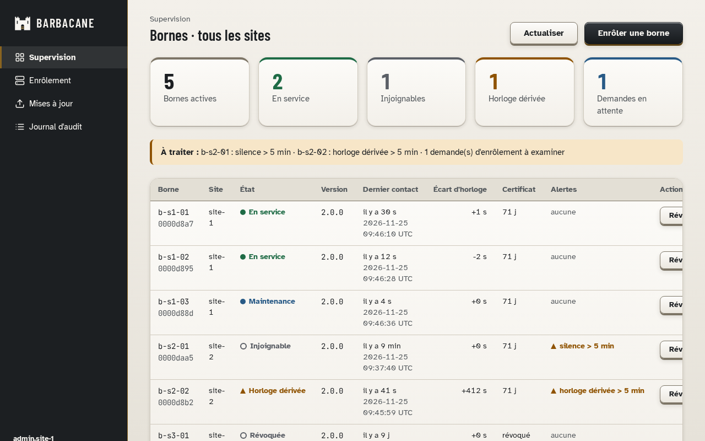

Une borne « injoignable » n'a pas battu depuis plus de 5 minutes ; « horloge dérivée » : écart de
plus de 5 minutes avec le serveur. Le certificat d'une borne vaut **90 jours** et se renouvelle
seul à mi-vie.

## 11.2 Révoquer une borne

Bouton **Révoquer** sur la ligne de la borne : motif obligatoire, et il faut **retaper le nom de
la borne**. La borne est aussitôt refusée par le serveur (liste de révocation republiée). Une
borne perdue ou volée doit être révoquée tout de suite.

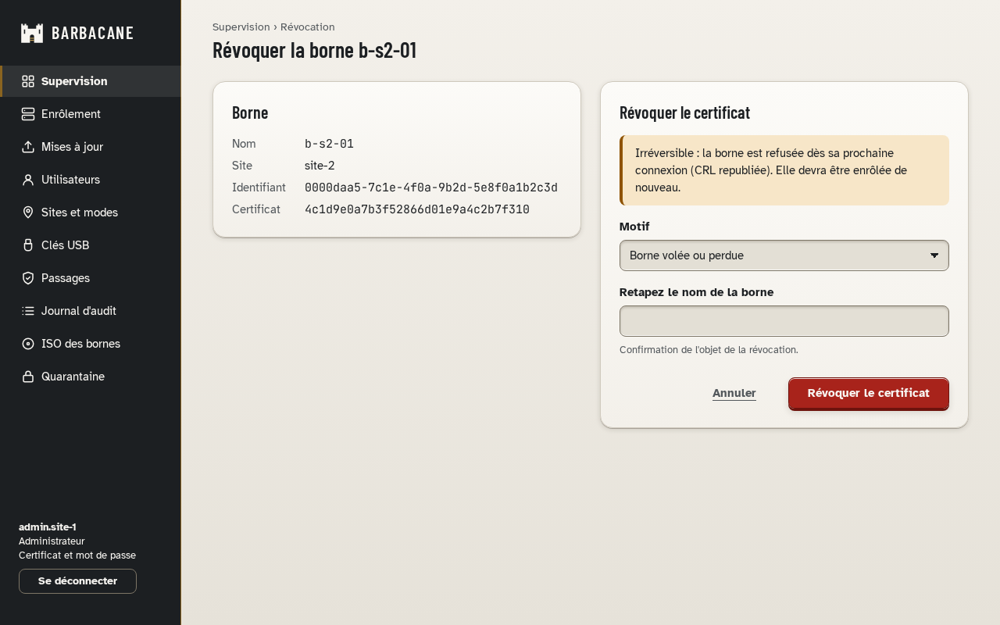

## 11.3 Mises à jour centralisées

Le serveur **ne signe jamais** une mise à jour : il relaie les paquets `.bcu` préparés et signés
hors ligne (§8), et chaque borne les **revérifie** comme pour une clé USB.

1. Une fois : préparer un **plancher** signé (version minimale acceptée), sur le poste hors ligne,
   avec la clé des mises à jour :
   `serveur/maj/barbacane-plancher-prepare --cle CLE --version-min N --sortie DOSSIER`.
2. Page **Mises à jour** : déposer le plancher (`plancher.json` + `.minisig`), puis le paquet
   (`.bcu` + `.bcu.minisig`). Le serveur refuse un paquet non signé, d'une autre clé, altéré,
   sous le plancher ou plus ancien qu'un paquet déjà déposé ; chaque refus est audité.
3. **Diffuser** le paquet. Chaque borne le télécharge au battement suivant, puis l'administrateur
   local l'applique depuis la page Serveur de la borne (§12.4). La page suit l'état par borne :
   proposée, téléchargée, appliquée ou échec.

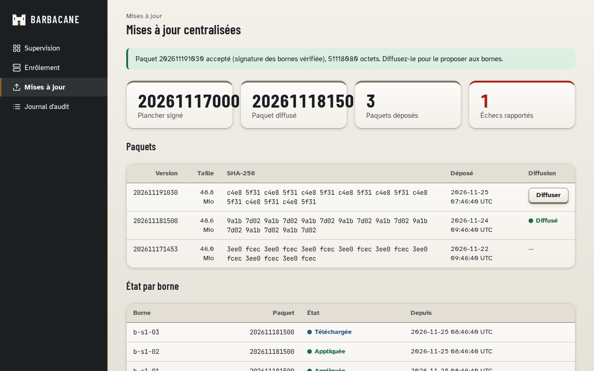

Il faut que le serveur connaisse la clé publique des bornes (`--cle-maj-bornes`, **v2.0.1**) ;
sinon tout dépôt est refusé.

## 11.4 Rapports de passage

Après chaque analyse, une borne en ligne envoie un **rapport minimal** : tailles, empreintes
SHA-256, verdicts, identifiant du support, **jamais de nom de fichier**. Page **Passages** : liste
par borne et détail. Si le serveur est injoignable, la borne garde ses rapports et les renvoie ;
si sa file est pleine, elle refuse toute nouvelle analyse (« Borne hors service ») jusqu'au retour
du serveur.

## 11.5 Utilisateurs et PIN

Chaque **site** a un mode (page **Sites et modes**) :

| Mode | Sur la borne |
|---|---|
| **Aucun** (défaut) | rien n'est demandé, comme la v1 |
| **Identification** | l'utilisateur tape son identifiant ; il doit être actif dans l'annuaire |
| **Authentification** | identifiant + **PIN Barbacane** (jamais le mot de passe de l'annuaire) |

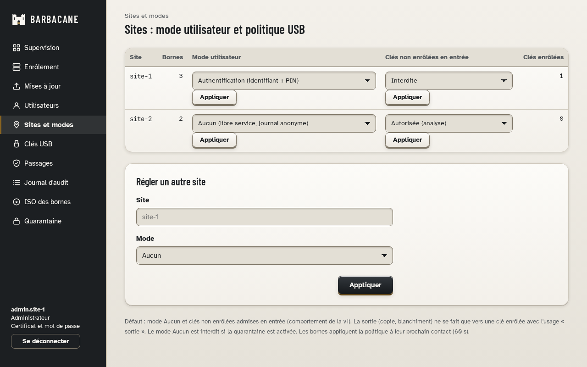

- **Annuaire** : page **Utilisateurs** → **Synchroniser** : la liste des identifiants est lue en
  LDAPS (compte de service en lecture seule). Les absents sont retirés et leur PIN effacé.
  La synchronisation périodique est prévue en v2.1.0 : relancez-la après chaque arrivée ou départ.
- **PIN** : **Réinitialiser le PIN** affiche un PIN initial de 8 chiffres **une seule fois** ; le
  remettre à l'utilisateur. À sa première identification, la borne lui fait choisir son propre PIN
  (6 à 12 chiffres, ni suite ni répétition).
- 5 PIN faux → compte **verrouillé** : **Déverrouiller** ou réinitialiser depuis la page.
- L'auditeur voit les identifiants en clair ; ailleurs (journal), ils sont pseudonymisés.

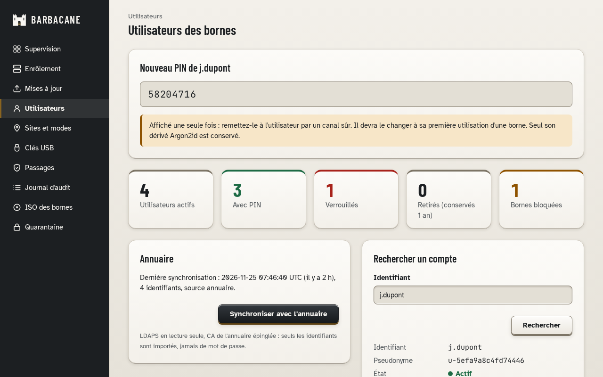

## 11.6 Clés USB enrôlées

Page **Clés USB** : enrôler une clé par **fabricant + numéro de série**, pour un site, avec ses
usages (entrée, sortie). Page **Sites et modes** : autoriser ou interdire en entrée les clés non
enrôlées.

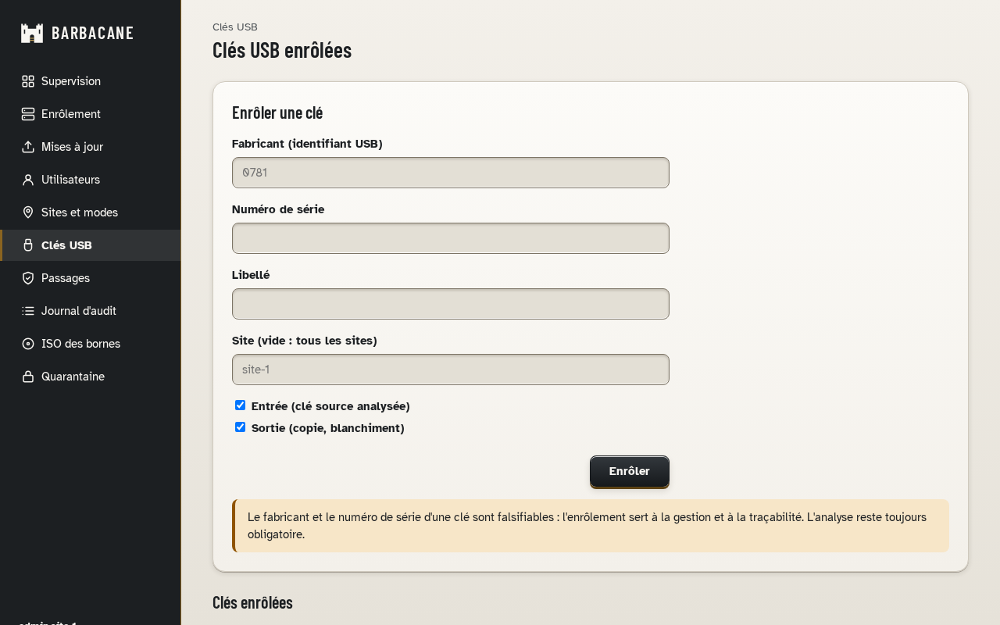

Dès qu'une politique est reçue, la borne en ligne :

- refuse une clé à analyser non autorisée (message, la clé est ignorée jusqu'à son retrait) ;
- ne **copie** des fichiers que vers une clé enrôlée en **sortie** (la gravure est alors refusée) ;
- autorise le **blanchiment** sur toute clé (il ne fait sortir aucune donnée).

Comme sur la borne hors ligne, un numéro de série peut être copié : c'est une mesure
d'organisation, pas un contrôle d'accès.

## 11.7 Quarantaine (option, désactivée par défaut)

La quarantaine conserve sur le serveur, chiffrés, des fichiers écartés pour analyse ultérieure.
Elle est **désactivée par défaut** ; rien n'est reçu tant qu'elle n'est pas activée.

> **Avertissement DR.** « Les fichiers conservés en quarantaine peuvent être de niveau Diffusion
> Restreinte (DR) : n'activez qu'avec un stockage et des accès conformes. » Cet avertissement est
> affiché et journalisé à l'activation.

- **Activation** (page **Quarantaine**) : demandée par un administrateur, **validée par un second
  administrateur** distinct dans l'heure ; la désactivation se fait par un seul.
- Conservation 30 jours, puis purge automatique ; chaque consultation est auditée ; l'export
  demande aussi une double validation et donne un fichier neutralisé (`quarantaine-<id>.bin`).
- L'envoi des fichiers par les bornes n'est pas encore livré (v2.1.0).

# 12. Bornes en ligne

## 12.1 Installer une borne en ligne

Même poste, même BIOS et même installation que la borne hors ligne (chapitres 2 à 5), avec un
câble réseau vers le réseau des bornes. L'installation se fait **toujours sans réseau** ; ensuite
la borne ne peut joindre **que** le serveur (pare-feu, et seul l'agent `barbacane-agent` a le droit
de sortir). Elle n'accepte aucune connexion entrante.

Deux ISO possibles :

| ISO | Quand | Enrôlement |
|---|---|---|
| **ISO en ligne générique** (§10.2, ou téléchargée depuis le serveur) | plusieurs bornes, ou ISO préparée à l'avance | jeton **saisi** sur la borne (§12.3) |
| **ISO personnalisée** (page « ISO des bornes ») | une installation immédiate | **sans saisie** : le jeton est dans l'ISO |

## 12.2 Télécharger une ISO depuis le serveur

::: v201
**Nécessite v2.0.1.** La page « ISO des bornes » fait partie de l'interface web (v2.0.1). Avec la v2.0.0, utilisez l'ISO en ligne générique construite au §10.2.
:::

Page **ISO des bornes** (administrateur seulement) :

- **ISO génériques** (en ligne, hors ligne) : téléchargement ; l'empreinte SHA-256 est affichée :
  **comparez-la à la note de version imprimée** (§10.2).
- **Préparer une ISO pour un site** : le serveur crée un jeton et produit une ISO personnalisée
  pour ce site, **téléchargeable une seule fois**, supprimée après le téléchargement ou au bout
  d'une heure. Elle contient un secret : installez-la tout de suite, puis détruisez-la.

Chaque préparation et chaque téléchargement sont audités.

## 12.3 Enrôler la borne

1. **Jeton** (ISO générique) : interface web, page **Enrôlement** → créer un jeton pour le site.
   Il est affiché **une seule fois**, vaut **1 heure** et sert **une seule fois**.

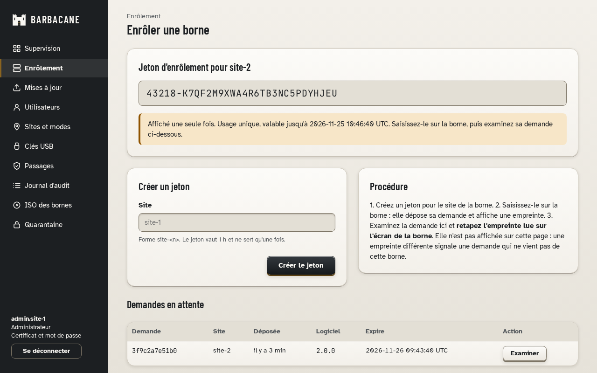

2. Sur la borne : choisir le PIN administrateur (§5), puis Administration → **Serveur** →
   **Saisir un jeton** (clavier virtuel ; minuscules acceptées). Avec l'ISO personnalisée, cette
   étape est faite toute seule au premier démarrage.
3. La page Serveur de la borne affiche une **empreinte** en groupes de 4 caractères.
4. Interface web, page **Enrôlement** → la demande en attente → **retaper l'empreinte lue sur la
   borne** (le serveur ne l'affiche pas, exprès) → **Valider et émettre le certificat**. Une empreinte différente est
   refusée et la demande reste en attente : en cas de doute, **Refuser la demande**.

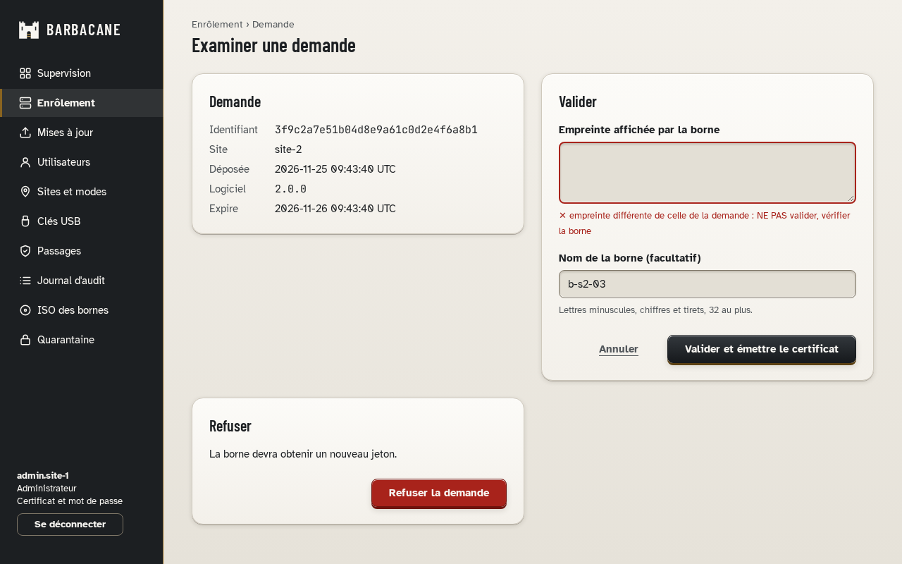

5. La borne reçoit son certificat (90 jours) et commence ses battements (toutes les 60 s) ; elle
   apparaît en service dans la supervision.

En console, la même chose : `sudo barbacane-registre jeton site-1`, `… demandes`,
`… valider ID EMPREINTE NOM` (**v2.0.1**).

## 12.4 Page Serveur de la borne et mises à jour

Administration → **Serveur** : adresse du serveur, état (non enrôlée, en attente de validation,
enrôlée, dégradée, refusée, agent arrêté), empreinte, dernière synchronisation, écart d'horloge,
rapports en attente, dernier message.

Quand le serveur diffuse une mise à jour, la page affiche « Mise à jour N reçue du serveur » →
**Vérifier et appliquer**. La borne refait **toutes** les vérifications d'une mise à jour par clé
(signature avec sa propre clé publique, anti-retour, manifeste) ; le serveur n'a aucune autorité
sur la signature. Le résultat est renvoyé au serveur. Si un redémarrage est demandé, procéder
comme au §8. Les mises à jour par clé USB restent possibles.

## 12.5 Identification sur la borne

Selon le mode du site (§11.5), la borne demande l'identifiant, puis le PIN, avant l'analyse.
Messages : « Identifiant ou PIN refusé. » ; « Borne bloquée … réessayez dans N min. ». Si le
serveur est injoignable, l'identification est impossible. Le PIN n'est jamais enregistré sur la
borne.

## 12.6 Ce qui change par rapport à la borne hors ligne

- bouton **Serveur** dans le menu d'administration, pied de page « station blanche en ligne » ;
- rapports de passage envoyés au serveur (§11.4) ;
- politique de site : identification (§11.5) et clés USB (§11.6), qui **remplacent** la liste
  locale du §6 dès qu'une politique est reçue ;
- sans politique reçue, la borne en ligne se comporte comme la borne hors ligne.

# 13. Dépannage du serveur et des bornes en ligne

| Symptôme | Cause probable / action |
|---|---|
| Le serveur demande une clé au démarrage | TPM effacé, carte mère ou démarrage sécurisé modifiés : saisir la **clé de secours** (coffre). |
| L'installation du serveur s'arrête aussitôt | Pas de TPM 2.0 actif : l'activer dans le micrologiciel. |
| Construction refusée : ports | Avec les ISO de bornes embarquées, `--port` et `--port-enrolement` doivent être ceux de l'ISO en ligne. |
| Interface web : connexion refusée sans page | Certificat d'administrateur absent, révoqué, ou **CRL des administrateurs expirée** : la republier. |
| « Identifiant ou mot de passe refusé » répété | Compte verrouillé après 5 échecs : attendre, ou vérifier que le certificat est bien celui du compte. |
| Passerelle ou interface web arrêtées, « condition non remplie » | PKI (ou CA des administrateurs) pas encore déposée : §10.5. |
| Borne « injoignable » | Câble, réseau des bornes, adresse ou ports du serveur ; la borne réessaie seule. |
| Borne « horloge dérivée » | Régler l'heure du serveur (§10.4) ; la borne prend l'heure du serveur. |
| Jeton refusé sur la borne | Jeton expiré (1 h), déjà utilisé, ou d'un autre port d'enrôlement : en créer un nouveau. |
| Validation d'enrôlement refusée | Empreinte mal retapée : relire la page Serveur de la borne. |
| Dépôt de mise à jour refusé | Lire le motif (journal d'audit) : pas de plancher, pas de clé des bornes, signature, version. |
| « Borne hors service » sur une borne en ligne | File des rapports pleine : rétablir la liaison avec le serveur. |

# 14. Sécurité et limites

## 14.1 PKI de TEST et production

Les ISO v2.0.0 publiées (`barbacane-2.0.0-en-ligne.iso`, `barbacane-serveur-2.0.0.iso`)
embarquent la **PKI de TEST** du dépôt (serveur 10.0.2.2, ports 43117/43118 du banc). Elles
servent à l'essai ; **ce ne sont pas des ISO de site**.

En production, la PKI est créée lors d'une **cérémonie** : racine hors ligne, puis CA des bornes,
du serveur et des administrateurs (politique de certification, `docs/suite/politique-certification.md`).
Les clés ne sont **jamais** dans une ISO de production : elles sont déposées sur le serveur après
la cérémonie (§10.5). La procédure de cérémonie de production est prévue en **v2.1.0**.

## 14.2 Mesures en place (v2.0)

- Serveur : disque chiffré LUKS2 scellé au TPM, pare-feu en liste blanche, aucune route par
  défaut, aucun accès distant, services en conteneurs sans root, journal persistant 1 an.
- Liaisons : TLS 1.3 mutuel seulement, liste de révocation relue à chaque connexion ; cryptographie
  conforme au RGS (P-384/P-256, AES-256-GCM, Argon2id).
- Interface web : certificat + mot de passe, rôles, protection CSRF, aucun JavaScript.
- Aucun nom de fichier transmis ; mises à jour toujours signées hors ligne et revérifiées.

## 14.3 Limites connues

- **Pas d'homologation** : décision de l'autorité d'homologation ; produits agréés hors projet
  (chiffreur IP DR entre sites, chiffrement de disque agréé, authentification forte, poste
  d'administration dédié).
- Clés de la PKI, de l'audit, de l'interface, de la quarantaine et secrets des utilisateurs : encore
  en fichiers protégés (0600), pas dans le TPM. Preuves faites avec un TPM logiciel seulement.
- Pas encore de double validation générale ni de second facteur matériel des administrateurs.
- Limites de la borne v1 toujours valables.

## 14.4 Prévu pour la v2.1.0

- **PKI et passerelle** : clés dans le TPM, refus des certificats TEST en production, CRL de la
  racine et republication quotidienne automatique, service PKI séparé ; cérémonie de production.
- **Enrôlement** : double validation des révocations massives ; PostgreSQL.
- **ISO serveur** : machine physique avec TPM matériel et démarrage sécurisé, re-scellement (shim,
  `systemd-pcrlock`), faillock, AIDE, GNSS/radio, sauvegarde planifiée.
- **Audit et mises à jour** : minuteries de scellement/export, clé d'audit dans le TPM, `chattr +a`,
  clé distincte pour le `.bcu` serveur, plancher étendu, diffusion par lot avec double validation.
- **Interface web** : TPM, service systemd durci, pare-feu d'administration, double validation
  générale, deux facteurs des administrateurs, comparaison aux exports d'audit, lecture de la fin
  du journal.
- **Utilisateurs et clés USB** : rattachement aux rapports, synchronisation périodique de
  l'annuaire, secrets dans le TPM, mode par borne, rôles de site ; LDAPS sur un vrai annuaire.
- **Borne en ligne** : clés dans le TPM, session jointe aux rapports, captures des nouveaux écrans.
- **Rapports de passage** : rapport d'analyse en échec, signature par la borne, rétention/purge,
  analyse réelle de bout en bout.
- **Quarantaine** : clé dans le TPM, chiffrement sur la borne pour une clé d'analyste hors
  serveur, envoi par l'agent, fichiers > 4 Mio.
- **Homologation** (hors logiciel) : décision de l'AH, produits agréés (chiffreur IP, disque,
  FIDO2/carte à puce, poste d'administration), cérémonie de la racine.
