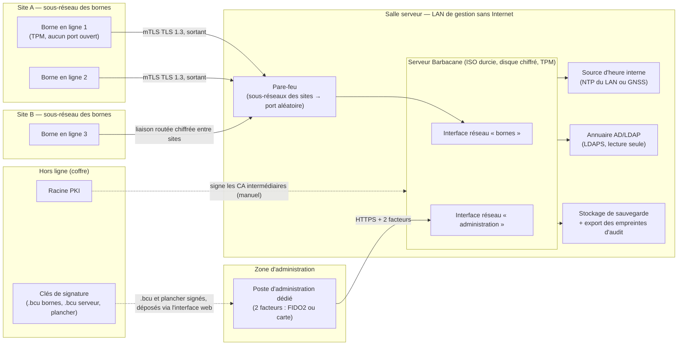
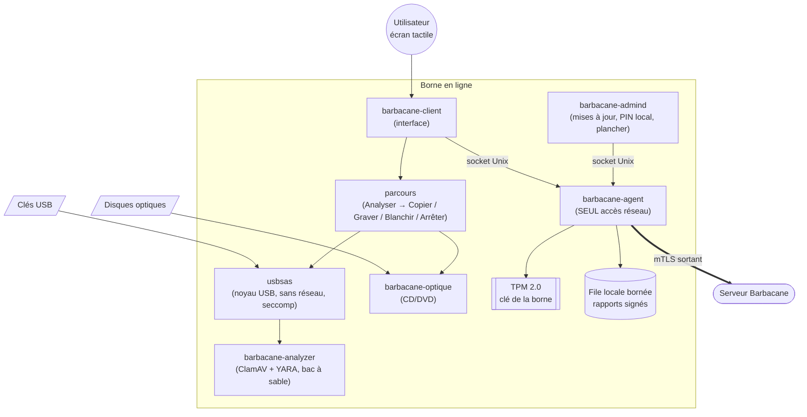
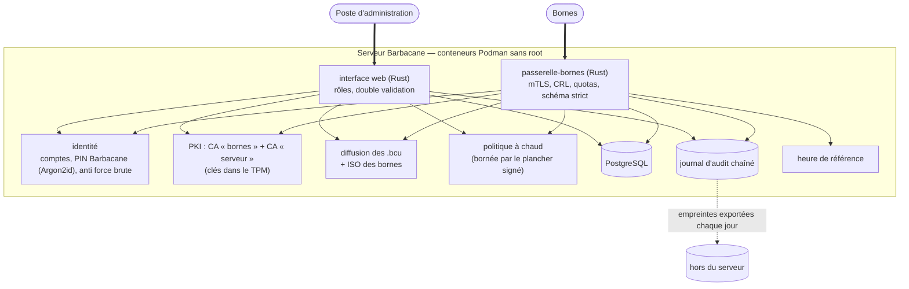
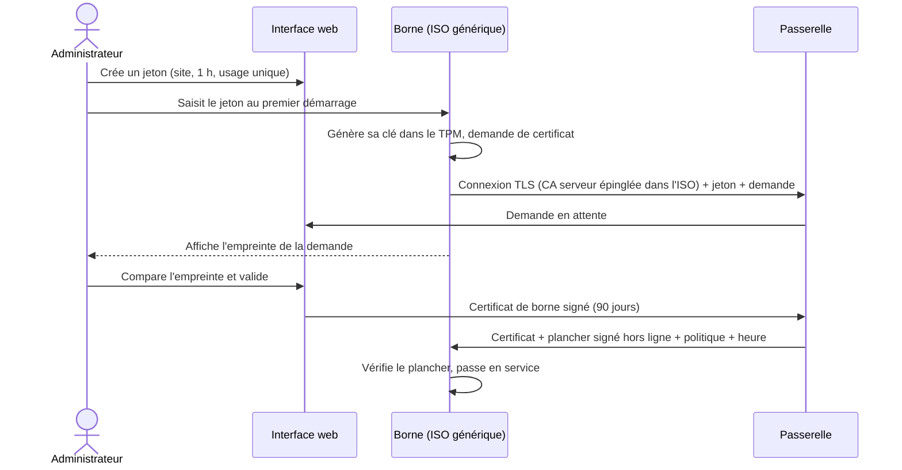
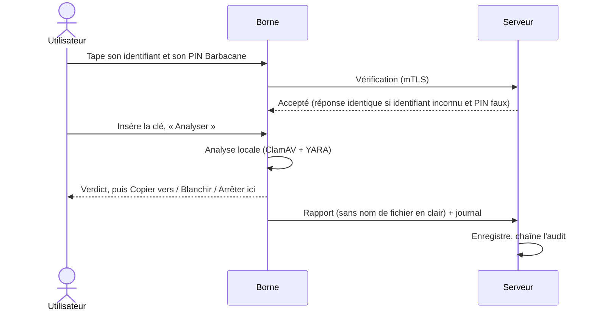

# Barbacane suite — gestion centralisée des bornes (conception)

Statut : **conception, aucun code**. Document de départ pour l'implémentation.
Barbacane v1 (borne hors ligne) reste inchangé : la « suite » est un **produit
distinct** (ISO borne en ligne + ISO serveur).
Révision du 19/11/2026 : intègre la revue de sécurité et de conformité
(`docs/suite/revue-conception-2026-11-19.md`).

## 1. Décisions prises

| Sujet | Décision |
|---|---|
| Échelle | 10 à 100 bornes. **Un serveur unique** pour commencer ; serveur central de consolidation prévu plus tard (§11). |
| Réseau | LAN de gestion **sans Internet**. Liaison entre sites **routée (niveau 3)**, un sous-réseau par site, chiffrée (§5) ; pas de VXLAN de niveau 2 étendu entre sites. |
| Sens des connexions | **La borne appelle le serveur** ; la borne n'écoute aucun port. **TLS 1.3 uniquement**, authentification mutuelle (mTLS). |
| Serveur injoignable | La borne en ligne **se bloque** après un court délai de grâce (§3.1). Les bornes v1 ne sont pas concernées. |
| Passage v1 → en ligne | **Réinstallation obligatoire** : la v1 ne contient aucun code réseau. |
| Livraison du serveur | **ISO dédiée** (Debian durcie, installation automatique hors ligne) embarquant les images de conteneurs, exécutées par **Podman sans root** (§3.4). |
| Enrôlement des bornes | Jeton à usage unique **et validation par un administrateur** (§3.5). |
| Analyse | **ClamAV et YARA restent sur la borne** : la décision (sain / bloqué) est prise localement, comme en v1. Le serveur gère, supervise et stocke. |
| Utilisateurs | Mode choisi par l'administrateur par site ou par borne : **Aucun**, **Identification**, **Authentification** (§3.3). Identifiant tapé à l'écran ; **PIN propre à Barbacane** ; aucun mot de passe d'annuaire saisi sur la borne. |
| Port | Port TCP non standard **tiré au hasard** à l'installation (choix de l'utilisateur ; réserve d'homologation, §3.2). |
| Données envoyées par la borne | État, rapports et journaux. **Quarantaine des fichiers malveillants désactivée par défaut** (§3.6). |
| Rôles web | Administrateur, administrateur de site, opérateur, auditeur (lecture seule). |
| Conservation | Journaux et rapports **1 an**, quarantaine **30 jours** (si activée), purge automatique, sauvegardes comprises (§3.8). |
| Cadre | **ANSSI** / homologation, **Diffusion Restreinte** (IGI 1300), **RGPD** (§5). |
| ISO des bornes | Téléchargées depuis l'interface web : **générique** (sans secret), **personnalisée** (jeton inclus, encadrée §9) et **hors ligne v1**. |
| Mises à jour | L'administrateur dépose le `.bcu` signé dans l'interface web ; le serveur le diffuse ; la borne revérifie. |
| Interface web | Techno au choix de l'implémentation ; préférence : pages générées par le serveur Rust, très peu de JavaScript. |
| Première étape | **Socle** (§8, étape 1), précédé de la validation du périmètre par l'autorité d'homologation (AH). |

## 2. Principes de sécurité

1. **Un serveur compromis ne compromet pas les bornes.**
   - Le serveur ne détient **jamais** les clés de signature hors ligne (mises à jour,
     politique de base) ; chaque borne les revérifie, avec anti-retour.
   - Le serveur ne peut pas exécuter de commande sur une borne : il publie, la borne
     récupère, vérifie et applique dans les limites d'un **plancher signé hors ligne** (§3.7).
   - Aucun secret d'utilisateur d'annuaire ne transite par une borne.
2. **Surface minimale de la borne** : aucun port en écoute, une seule connexion sortante
   (adresse et port du serveur), tout le reste refusé (nftables).
3. **Identité forte de chaque borne** : clé privée générée et scellée dans le **TPM 2.0
   (exigé)** ; disque chiffré et scellé au TPM avec démarrage sécurisé. Une borne sans TPM
   n'est pas éligible au mode en ligne.
4. **Les identifiants USB ne prouvent rien** (VID/PID/numéro de série falsifiables) :
   gestion et traçabilité seulement ; l'analyse reste toujours obligatoire.
5. **Pas de donnée sensible sur le serveur par défaut** : pas de quarantaine, noms de
   fichiers non transmis en clair dans les rapports (empreinte ou nom tronqué, §3.6).
6. **Traçabilité vérifiable hors du serveur** : journal d'audit chaîné, dont les
   empreintes sont exportées régulièrement hors du serveur (§3.9).
7. **Tout contenu venant d'une borne est hostile** pour le serveur : schéma strict,
   quotas, échappement systématique dans l'interface web.
8. **Noyau usbsas sans réseau** : l'agent est un composant Barbacane séparé.

## 2 bis. Schémas

### Infrastructure (vue réseau)



Les flèches pleines sont les seules connexions réseau autorisées ; les pointillés sont
des transferts manuels (support amovible, cérémonie de clés).

### Logiciel de la borne en ligne



La décision « sain / bloqué » est prise dans la borne (analyzer) ; l'agent ne fait que
transporter état, rapports, politique et mises à jour.

### Logiciel du serveur



### Séquence : enrôlement d'une borne



### Séquence : utilisation (mode authentification)



### Rendu attendu de l'interface web (maquette indicative)

```
┌─ Barbacane — Supervision ─────────────────────── admin.site-a  ⏻ ┐
│ Bornes 12 │ En service 11 │ Hors service 1 │ Signatures > 7 j 0  │
├───────────┬──────────┬────────────┬──────────────┬───────────────┤
│ Borne     │ Site     │ État       │ Signatures   │ Dernier contact│
│ B-A-01    │ Site A   │ ● En service│ il y a 2 h  │ il y a 30 s    │
│ B-A-02    │ Site A   │ ● En service│ il y a 2 h  │ il y a 12 s    │
│ B-B-01    │ Site B   │ ○ Injoignable│ il y a 1 j │ il y a 9 min   │
├───────────┴──────────┴────────────┴──────────────┴───────────────┤
│ [Enrôler une borne] [Déposer une mise à jour] [ISO des bornes]    │
│ [Utilisateurs] [Clés USB] [Rapports] [Audit] [Politique]          │
└───────────────────────────────────────────────────────────────────┘
```

## 3. Architecture

```
┌──────── LAN de gestion (sans Internet), un sous-réseau routé par site ────────┐
│                                                                                │
│  Borne Barbacane en ligne (ISO distincte de la v1, TPM 2.0 exigé)              │
│   usbsas + analyseur + interface (comme v1)                                    │
│   barbacane-agent ── sortant unique, TLS 1.3, mTLS (clé dans le TPM) ──┐       │
│     • récupère : politique (dans le plancher signé), clés enrôlées,    │       │
│       mises à jour .bcu, heure de référence                            │       │
│     • envoie : état, rapports, journaux (quarantaine : option)         │       │
│                                                                        ▼       │
│  Serveur Barbacane (ISO durcie, conteneurs Podman sans root)  port aléatoire   │
│   ┌ passerelle-bornes (Rust) : seul point d'entrée, mTLS, CRL, quotas          │
│   ├ interface web : INTERFACE RÉSEAU DISTINCTE, poste d'administration dédié, │
│   │   authentification à deux facteurs, rôles, double validation (§3.10)      │
│   ├ identité : comptes et PIN Barbacane ; annuaire en LDAPS pour les           │
│   │   identifiants uniquement                                                 │
│   ├ PKI : racine HORS LIGNE ; CA « bornes » et CA « serveur » séparées        │
│   ├ diffusion des mises à jour, ISO des bornes                                 │
│   ├ base PostgreSQL ; journal d'audit chaîné                                   │
│   └ heure de référence (source interne, §3.11)                                 │
└────────────────────────────────────────────────────────────────────────────────┘
```

### 3.1 Borne en ligne

- Même base que la v1. Nouveau service `barbacane-agent` (Rust, utilisateur dédié,
  durci) : seul processus autorisé sur le réseau, vers le seul serveur.
- L'interface ne parle qu'à l'agent local (socket Unix).
- **Blocage** : si le serveur est injoignable, la borne finit la session en cours puis se
  bloque après un délai de grâce court (5 minutes par défaut, réglable dans le plancher
  signé, jamais au-delà de 24 h). Pendant ce délai : dernière politique valide, rapports
  mis en file locale, signés par la borne. **File pleine → blocage**, jamais de perte.
  Message : « Borne hors service : serveur de gestion injoignable ».
- Certificat de borne : durée **90 jours**, renouvelé automatiquement par l'agent à
  mi-vie ; alerte à l'administrateur 30 jours avant toute expiration.

### 3.2 Port d'écoute

Port TCP tiré au hasard à l'installation (plage 20000–60000, hors ports connus),
modifiable, inscrit dans le jeton d'enrôlement. Mesure de **discrétion** seulement (un scan
complet le trouve). Réserve : un port fixe documenté facilite le filtrage et
l'homologation ; **à faire valider par l'AH**. La protection reste le mTLS, la CRL et le
pare-feu (§3.5).

### 3.3 Utilisateurs : identification et authentification

- **Identification** : savoir *qui* fait quoi (journalisation). Rien ne prouve que c'est lui.
- **Authentification** : être *sûr* que c'est lui.

| Mode | Ce qui est demandé | Usage |
|---|---|---|
| Aucun | rien (comme la v1) | libre service, journal anonyme ; **interdit si la quarantaine est activée** |
| Identification | identifiant tapé à l'écran (badge plus tard) | traçabilité |
| Authentification | identifiant tapé + **PIN Barbacane** (6 chiffres minimum) | preuve de l'identité |

- Identifiant tapé sur le clavier virtuel de l'écran tactile ; aucun lecteur en v2.0.
- **Aucun mot de passe d'annuaire n'est saisi sur une borne.** L'annuaire AD/LDAP sert
  seulement à fournir la liste des identifiants (LDAPS avec vérification de la CA,
  compte de service en lecture seule, droits minimaux).
- PIN stocké sur le serveur sous forme dérivée (Argon2id), jamais sur la borne.
- **Anti force brute** : verrouillage par identifiant **et** par borne après 5 échecs,
  délai croissant, alerte à l'administrateur.
- **Pas d'énumération** : en mode authentification, la réponse est identique que
  l'identifiant existe ou non. En mode identification, un identifiant inconnu est refusé.
- Badges (plus tard) : préférer un lecteur **CCID/PC-SC** à un lecteur émulant un clavier
  (contournable par un faux clavier USB). Un badge simple seul ne vaut qu'identification.

### 3.4 Serveur

- ISO Debian durcie (guide ANSSI GNU/Linux), installation automatique hors ligne, **disque
  chiffré** (clé scellée au TPM du serveur).
- Conteneurs exécutés par **Podman sans root** (pas de démon root), images chargées depuis
  l'ISO, systèmes de fichiers en lecture seule.
- Deux interfaces réseau : **bornes** (passerelle) et **administration** (interface web),
  séparées par le pare-feu.
- **Secrets du serveur** (clé de la CA intermédiaire, clé de signature de l'audit, compte
  de service LDAP, base de données) : dans le TPM ou dans des fichiers chiffrés déverrouillés
  au démarrage par le TPM ; un compte système par service ; rotation documentée.

### 3.5 PKI et enrôlement

- **Racine hors ligne** (support chiffré au coffre, détenteurs nommés), deux CA
  intermédiaires : « bornes » (certificats clients) et « serveur » (certificat TLS).
  Clés intermédiaires dans le TPM ou un HSM si disponible.
- **Politique de certification** minimale écrite avant l'étape 1 : profils, algorithmes
  (ECDSA P-256 ou P-384), durées, révocation.
- **Révocation** : CRL locale vérifiée par la passerelle à chaque connexion (pas d'OCSP,
  rien n'est joignable hors du LAN).
- **L'ISO de la borne embarque l'empreinte de la CA serveur** : la borne authentifie le
  serveur dès le premier contact (aucune confiance aveugle au premier usage).
- **Enrôlement** : jeton à usage unique, lié à un site, valable **1 h** ; la borne envoie sa
  demande de certificat (clé générée dans le TPM) ; la demande reste **en attente** jusqu'à
  ce qu'un administrateur compare l'empreinte affichée sur la borne à celle de l'interface
  web et l'accepte.
- Pare-feu du serveur : accepte le port des bornes depuis les **sous-réseaux des sites**
  déclarés (l'enrôlement vient d'une adresse pas encore connue).

### 3.6 Données envoyées et quarantaine

- Par défaut : état, rapports, journaux. **Les noms de fichiers ne sont pas transmis en
  clair** (empreinte sha256, extension et taille seulement ; nom complet consultable sur
  la borne). Identifiant d'utilisateur pseudonymisé dans les rapports consultés hors du
  rôle auditeur.
- **Quarantaine désactivée par défaut.** Si l'AH l'autorise (variante homologuée DR) :
  - fichiers chiffrés sur la borne pour une **clé de quarantaine dont la clé privée n'est
    PAS sur le serveur** (carte à puce d'un rôle « analyste ») ;
  - déchiffrement uniquement dans une VM d'analyse isolée, jamais sur le poste
    d'administration ni sur le serveur ; jamais de décompression ni d'aperçu côté serveur ;
  - restitution neutralisée (archive protégée, nom modifié), téléchargements journalisés,
    double validation (§3.10) ;
  - purge à 30 jours, sauvegardes comprises.

### 3.7 Politique et plancher signé hors ligne

- **Plancher signé hors ligne** (même clé ou clé dédiée de la chaîne `.bcu`, avec
  anti-retour) : liste des CA de confiance, sites, paramètres non négociables (analyse
  toujours active, modes utilisateur autorisés, délai de grâce maximal, quarantaine
  autorisée ou non).
- **Politique à chaud** (signée par le serveur) : uniquement des paramètres listés, chacun
  borné par le plancher. Version monotone par borne (anti-rejeu). Toute baisse de niveau
  exige la double validation (§3.10) et est journalisée.

### 3.8 Sauvegarde et reprise

- Sauvegarde chiffrée quotidienne (base, configuration, CA intermédiaires, empreintes
  d'audit), copie hors du serveur ; purges appliquées aussi aux sauvegardes (rotation
  courte).
- **Restauration testée en CI** ; procédure de reprise écrite (objectif : bornes à nouveau
  en service en moins de 4 h).

### 3.9 Journal d'audit

- Entrées chaînées par empreinte et signées par le serveur ; horodatées à la réception.
- **Empreintes de la chaîne exportées chaque jour hors du serveur** (support non
  réinscriptible ou serveur de journaux distinct) : une réécriture par un administrateur
  système devient détectable.
- Séparation des rôles : l'administrateur système (accès root, console) n'est pas
  administrateur applicatif ; ses accès sont journalisés à part.

### 3.10 Administration

- Poste d'administration **dédié**, conforme aux recommandations ANSSI d'administration
  sécurisée ; interface web joignable seulement depuis l'interface d'administration.
- Authentification à deux facteurs hors ligne (clé FIDO2 ou carte à puce).
- **Double validation** (deux personnes) : révocation massive, baisse de politique,
  activation ou export de quarantaine.

### 3.11 Heure

- Le serveur est la référence : source interne (NTP du LAN, ou récepteur GNSS/radio).
- Les bornes ne prennent l'heure **que** par le canal mTLS authentifié ; écart supérieur à
  5 minutes → resynchronisation, sinon blocage.
- Rapports et journaux horodatés par la borne **et** à la réception par le serveur.

## 4. Flux

| Flux | Sens | Contenu | Protection |
|---|---|---|---|
| Enrôlement | borne → serveur | jeton + demande de certificat | jeton 1 h, usage unique ; validation par un administrateur ; CA serveur épinglée |
| Battement | borne → serveur | état, version, âge des signatures, espace disque, écart d'horloge | mTLS |
| Plancher | borne ← serveur | plancher signé hors ligne | signature hors ligne + anti-retour, vérifiés par la borne |
| Politique | borne ← serveur | paramètres listés | bornée par le plancher, version monotone |
| Mise à jour | borne ← serveur | `.bcu` + `.minisig` | signature hors ligne vérifiée par la borne |
| Utilisateur | borne → serveur | identifiant, PIN Barbacane selon le mode | mTLS ; anti force brute ; aucune conservation sur la borne |
| Rapports, journaux | borne → serveur | JSON (schéma strict), journald | mTLS ; quotas ; noms de fichiers non transmis en clair |
| Quarantaine (option) | borne → serveur | fichiers malveillants | chiffrés pour une clé privée hors du serveur |

## 5. Conformité

- **ANSSI** : TLS 1.3 seul (suites et courbes fixées), PKI avec politique de certification,
  journalisation et administration sécurisée selon les guides ANSSI, durcissement Debian.
- **Diffusion Restreinte** : par défaut, **aucune donnée DR sur le serveur** (pas de
  quarantaine, pas de noms de fichiers). La variante avec quarantaine fait du serveur un
  SI DR : **homologation DR propre**, produits agréés DR (chiffreur IP entre sites),
  postes d'administration homologués, pas d'interconnexion avec un SI de niveau inférieur.
  **Périmètre à valider avec l'AH avant l'étape 1.**
- **Liaison entre sites** : routée et chiffrée par un produit adapté au niveau visé
  (agréé DR si la variante DR est retenue) ; le VPN seul ne suffit pas forcément (AH).
- **RGPD** : registre de traitement ; **analyse d'impact (AIPD)** (journalisation
  nominative du personnel) ; information des agents et consultation des instances
  représentatives ; durée d'un an justifiée par la traçabilité des incidents ;
  pseudonymisation ; droits d'accès des personnes ; purges appliquées aux sauvegardes.

## 6. Analyse des risques (principales menaces)

| Menace | Mesure |
|---|---|
| Serveur compromis qui pousse du code | Aucun code poussé ; `.bcu` signés hors ligne, vérifiés par la borne. |
| Serveur compromis qui affaiblit la politique | Plancher signé hors ligne ; politique à chaud bornée, version monotone, double validation, audit. |
| Serveur compromis qui récolte des secrets | Aucun mot de passe d'annuaire saisi sur les bornes ; PIN dérivés (Argon2id) ; quarantaine désactivée ou clé privée hors serveur. |
| Borne compromise ou clonée | Clé dans le TPM, disque scellé ; certificat 90 jours ; révocation (CRL) ; quotas, schéma strict, échappement côté serveur. |
| Faux rapports, injection dans l'interface web | Schéma strict, quotas par borne, échappement systématique. |
| Force brute des PIN | Verrouillage par identifiant et par borne, délai croissant, alerte. |
| Énumération des identifiants | Réponse identique en mode authentification. |
| Vol du jeton ou de l'ISO personnalisée | Jeton 1 h, usage unique ; validation de l'enrôlement par un administrateur. |
| Usurpation du serveur au premier contact | Empreinte de la CA serveur dans l'ISO. |
| Faux clavier / faux lecteur de badges | Pas de lecteur en v2.0 ; plus tard, lecteur CCID plutôt qu'émulation clavier. |
| Fausse clé « connue » (VID/PID/SN) | Traçabilité seulement ; analyse toujours obligatoire. |
| Fuite de données DR | Pas de DR sur le serveur par défaut ; variante DR homologuée à part. |
| Panne serveur, coupure réseau, certificat expiré | Délai de grâce borné ; renouvellement automatique et alertes ; sauvegarde et reprise testées. |
| Horloge faussée | Heure du serveur par le canal authentifié ; blocage si l'écart persiste. |
| Administrateur malveillant | Rôles séparés, double validation, audit exporté hors du serveur. |

## 7. Questions ouvertes

- Périmètre DR, port aléatoire, liaison entre sites : **décision de l'AH**.
- Qui détient la racine de la PKI et la clé de quarantaine (si activée).
- Source d'heure du site (NTP interne existant ou récepteur dédié).

## 8. Découpage en étapes

0. **Préalable** : validation du périmètre par l'AH ; politique de certification ; AIPD.
1. **Socle** : ISO serveur (Debian durcie, Podman sans root, disque chiffré), PKI (racine
   hors ligne, deux CA), passerelle mTLS avec CRL, enrôlement validé, heure, battement et
   supervision, sauvegarde/restauration testée.
2. **Mises à jour** : dépôt du `.bcu`, diffusion, suivi ; plancher signé hors ligne.
3. **Rapports et journaux** : schéma strict, quotas, conservation, audit exporté.
4. **Utilisateurs** : modes Aucun / Identification / Authentification (PIN Barbacane),
   anti force brute, liste d'identifiants depuis l'annuaire (LDAPS).
5. **Clés USB** : enrôlement par fabricant + numéro de série, politiques par site.
6. **Quarantaine** (option, variante homologuée) : clé privée hors serveur, VM d'analyse.
7. **Plus tard** : badges (CCID), analyse complémentaire, serveur central, redondance.

Chaque étape : conception détaillée, tests automatisés, preuves, CI verte.

## 9. Téléchargement de l'ISO des bornes depuis le serveur

L'ISO du serveur **embarque l'ISO de la borne en ligne** de la même version. L'interface
web (rôle administrateur) propose :

- **ISO générique** : sans secret, avec l'empreinte de la CA serveur ; enrôlement au premier
  démarrage par jeton. Son empreinte se vérifie **hors bande** (note de version imprimée),
  pas seulement sur la page du serveur.
- **ISO personnalisée** : jeton (1 h, usage unique), adresse, port et site inclus.
  L'enrôlement reste soumis à la validation par un administrateur ; téléchargement
  journalisé ; à préparer au moment de l'installation et à détruire après usage.
- **ISO hors ligne v1**, signalée « borne sans serveur ».
- Produites **sans Internet** par le serveur (remaster de l'ISO embarquée).
- Mises à jour du serveur : `.bcu` serveur signé par une **clé distincte** de celle des
  bornes (étiquette d'usage, anti-retour) ; il apporte la nouvelle ISO des bornes.

## 10. Organisation du dépôt (sans casser la v1)

Un seul dépôt `Titouanlvt/Barbacane`. **La v1 hors ligne reste le produit de référence** :
`git clone` puis `systeme/iso/build-iso.sh` doit continuer à produire exactement la
même borne hors ligne, sans aucun code réseau.

```
noyau/            inchangé (lecture USB, issu d'usbsas)
borne/            inchangé (client, analyzer, admind, parcours, update, optique)
borne/agent/      NOUVEAU : barbacane-agent (borne en ligne uniquement)
serveur/          NOUVEAU : passerelle, interface web, identité, PKI, conteneurs
serveur/iso/      NOUVEAU : ISO du serveur
systeme/iso/      build-iso.sh --profil hors-ligne (défaut, = v1) | en-ligne
tests/            + tests/suite/ (serveur, agent, bout en bout)
```

Règles :
- Le profil **hors-ligne est le défaut** : sans option, `build-iso.sh` produit la v1.
- `barbacane-agent` et toute configuration réseau n'existent **que** dans le profil
  en-ligne. Un test de CI ouvre l'ISO hors ligne et **échoue** si elle contient l'agent, un
  paquet réseau ou une règle de pare-feu autorisant une sortie.
- La CI existante (ISO hors ligne + `tests/iso/qemu.sh`) reste obligatoire avant toute
  fusion dans `main` ; les nouveaux jobs s'y ajoutent.
- Documentation v1 inchangée ; la suite a ses documents dans `docs/suite/`.
- Versions : v1.x hors ligne ; la suite démarre en v2.0. Une étiquette git par version.

## 11. Évolution prévue : serveur central

Plus tard, un serveur central consolidera plusieurs serveurs de site (consolidation seule
recommandée : chaque site reste maître de ses bornes). Les choix de l'étape 1
(identifiants uniques de site, PKI hiérarchique, audit exportable) doivent le permettre
sans refonte.
