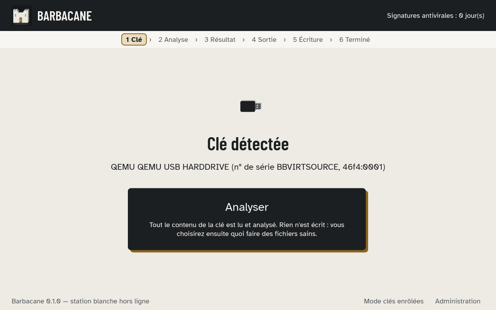

# Utilisation de la borne Barbacane

La borne vérifie une clé USB d'origine inconnue et ne laisse passer que les
fichiers sains. Elle s'utilise **uniquement à la souris**.

## Le parcours : analyser d'abord, décider ensuite

Le même parcours vaut pour une clé USB et pour un CD/DVD :

1. Branchez la clé à vérifier sur le port **ENTRÉE** (ou insérez le disque).
2. Cliquez **Analyser**. Rien n'est écrit à cette étape.
3. Patientez pendant la lecture et l'analyse. Tous les fichiers sont analysés,
   y compris le contenu des archives et des images (zip, 7z, rar, iso, wim, …).
4. Si une archive est protégée par un mot de passe, saisissez-le avec le
   clavier à l'écran puis **Valider**. **Ignorer cette archive** la refuse.
   Après 3 erreurs, ou sans réponse pendant 5 minutes, l'archive est refusée.
5. Le **résultat** s'affiche : nombre de fichiers sains, fichiers refusés et
   **pourquoi**. Vous choisissez alors :
   - **Copier vers une clé connue** : branchez une clé de destination sur le port
     **SORTIE** (son contenu actuel sera **entièrement effacé**), puis **Effacer cette
     clé et y copier les fichiers** ;
   - **Graver sur un disque** (borne équipée d'un graveur) : disque réinscriptible ;
   - **Blanchir la clé** (ou **Blanchir le disque** s'il est réinscriptible) : le support
     analysé est **entièrement effacé**, puis seuls ses fichiers sains y sont réécrits.
     Gardez le bouton **Maintenir pour effacer** enfoncé 2 secondes (le relâcher avant
     annule : rien n'est effacé). Ne retirez rien avant le message « Terminé » ;
   - **Arrêter ici** : rien n'est écrit nulle part ; retirez la clé.

Sur la clé de destination (ou la clé blanchie) :
- les fichiers sains, avec leur arborescence ;
- pour une archive qui contenait un fichier refusé : l'archive n'est pas copiée,
  ses fichiers sains sont dans un dossier `<nom de l'archive>.extrait/` ;
- le rapport `rapport-barbacane-<date>.txt` (et `.html`) : ce qui est passé, ce
  qui a été refusé et pourquoi.

Une clé trop volumineuse pour la borne est refusée dès le début de la lecture, avec la
taille du contenu et l'espace disponible (rien n'est copié).

Si un message d'erreur apparaît pendant l'écriture : la clé a pu être effacée
sans être réécrite. **Ne l'utilisez pas** ; laissez-la branchée et cliquez
**Réessayer l'écriture** (l'analyse n'est pas refaite).

## Messages fréquents

| Message | Signification |
|---|---|
| menace détectée par ClamAV / YARA : … | le fichier contient un code malveillant connu |
| archive chiffrée : … | archive protégée sans mot de passe valide |
| taux de compression suspect / taille décompressée trop grande / trop de fichiers / archive trop imbriquée | archive anormale (« bombe ») ou trop grande : elle est refusée en entier |
| archive contenant des chemins dangereux | noms de fichiers piégés : l'archive n'est pas copiée, ses fichiers sains sont extraits |
| fichier système écarté | fichier sans intérêt (Thumbs.db, autorun.inf, raccourcis…) |
| Cette clé n'est pas enrôlée | la borne n'accepte que certaines clés de sortie |
| contenu trop volumineux pour cette borne | l'analyse demande environ 3 fois la taille du contenu ; voir l'administrateur |
| ⚠ Signatures antivirales anciennes | prévenir l'administrateur (mise à jour à faire) |

Aucun fichier de la clé source n'est jamais exécuté ni ouvert par l'ordinateur :
la clé est lue par un programme dédié, sans passer par le système.
